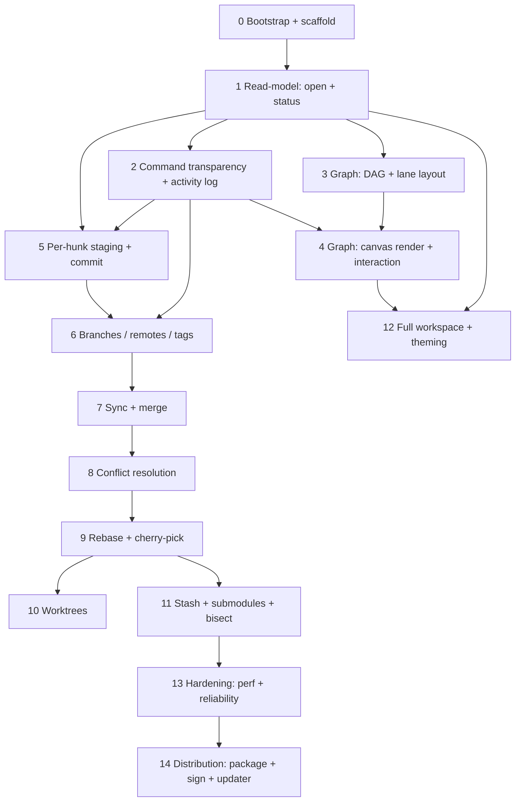

# GitGotten — Implementation Plan

A stage-by-stage build plan for the **GitGotten** visual Git manager (see [`SPEC.md`](./SPEC.md)
for the full product spec). Written for an **AI coding agent** to follow. Each stage is a
self-contained, testable, shippable increment that ends with a **git commit + push**.

---

## 0. How to use this plan (read this first)

### The mission
Build GitGotten exactly as specified in `SPEC.md`: a cross-platform (macOS first, Windows
second) Tauri v2 + React + TypeScript app with a Rust core (`gix` for reads, git CLI for
writes), a transparent command layer, a full multi-repo workspace, full worktree support,
and an interactive lane-DAG branch graph as the centerpiece.

### Toolchain (install once, before Stage 0)
- **Rust** (stable, via `rustup`) + `cargo`
- **Node** (LTS) + `pnpm`
- **Tauri v2** prerequisites for macOS (Xcode CLT, `libwebkit2gtk` is Linux-only — not needed on macOS) and the `tauri` CLI: `pnpm add -D @tauri-apps/cli`
- **git** (the real binary the app shells out to)
- Primary dev/test OS: **macOS**. Windows is used for the gates marked below.

### The fixed per-stage workflow (do these, in order, every stage)
1. **Design** — confirm the files, types, functions, and UI components this stage adds (they are enumerated per stage). If the design is ambiguous, resolve it *here* before writing code.
2. **Create tests (write them first, red)** — write the failing tests that encode the stage's spec. These are your acceptance contract.
3. **Build** — implement until the tests pass.
4. **Test** — run the full test suite (`cargo test` + `pnpm test` + `tauri build`). All green.
5. **Verify** — run the app and exercise the changed surface by hand (steps given per stage). macOS is primary; do the Windows gate where the stage marks it.
6. **Commit** — `git add -A && git commit -m "<message>"` using the stage's message.
7. **Push** — `git push origin main`. **Do not start the next stage until the push succeeds.**

### Definition of Done (a stage is complete when ALL are true)
- [ ] Tests exist, were written to fail first, and now pass.
- [ ] `cargo test` passes (Rust), `pnpm test` passes (web), `pnpm build` passes (web prod build), `tauri build` produces a runnable app.
- [ ] Hand-verified on **macOS** (and the Windows gate where marked).
- [ ] Committed **and pushed** to `git@github.com:sivartydrup/git-gotten.git`.
- [ ] No dead code, no `TODO`/placeholder stubs, no commented-out scaffolding left behind.
- [ ] `SPEC.md` is still accurate (update it if the design diverged).

### Branch & commit strategy
- Work on a single branch: **`main`**. One commit per stage (squash a stage's WIP into one commit before pushing — the commit is the unit of delivery).
- Commit message format: `stage-NN: <kebab-summary>` (e.g. `stage-03: graph-lane-layout`).
- Push after every stage: `git push origin main`.
- The planning docs (`SPEC.md`, `PLAN.md`) are committed in the baseline (Stage 0).

### Run / test commands (canonical)
```bash
cargo test                                   # all Rust tests (unit + integration, incl. fixtures)
pnpm test                                    # web tests (Vitest)
pnpm build                                   # web production build (-> dist/)
cargo run -p git-gotten-app                  # dev run with real web (or: pnpm tauri dev)
pnpm tauri build                            # full release build (bundles web into binary)
pnpm tauri dev                              # hot-reload dev (web on :1420, native window)
```

### Global constraints (non-negotiable)
- **Transparency invariant:** every mutating op produces a `CommandPlan` (literal git argv + risk + effect summary) and appears in the activity log. The *displayed* string is the single source of truth (§SPEC 8–9). Never run a write the UI cannot show.
- **Safe failure:** a failed op logs the exact command + output and rolls UI state back; no silent partial state.
- **No shell strings:** all subprocess uses argv vectors (no `sh -c`).
- **Portability:** Rust code is OS-agnostic; the web UI is identical across OSes. Windows-specific work is only: config-dir paths, file-watcher backend, process/editor hand-off, and packaging.
- **TDD:** tests before or alongside implementation; keep permanent tests that catch real bugs (per the workflow in SPEC §15).

### When to ask the human (do NOT guess on these)
- A decision that changes the **product** (scope, a SPEC decision in §20 defaults).
- A **destructive** action outside the sandbox (deleting the user's real repos, force-pushing the `git-gotten` remote, rewriting published history).
- Missing **infra**: code-signing certs, notarization, updater hosting — these block Stage 14; report and stop rather than fake it.
- A test you cannot make pass after a genuine effort: report the exact failure, your diagnosis, and the smallest change you propose.

### Platform gates
- **macOS is primary.** Verify every stage on macOS.
- **Windows** is required at: Stage 2 (process/editor hand-off), Stage 5 (paths + `apply --cached`), Stage 6 (fetch/push against a local remote), Stage 10 (worktree paths), Stage 12 (config dir), and Stage 14 (packaging). For all other stages, a quick Windows *sanity* run at the end of the milestone is enough. When a Windows machine is unavailable, note it in the stage's verification and proceed — do not block on it.

### Stage dependency graph

Stages that can **parallelize** (independent once their inputs exist): `{3, 5, 6}` after `{1,2}`; `{10, 11}` after `9`. Otherwise run in numeric order.

---

## Stage 0 — Bootstrap & workspace scaffold

**Goal:** a `git-gotten` repo that builds to a runnable (blank) Tauri window on macOS, with the crate workspace and web app scaffolded, the git remote wired, and the baseline (spec + plan) committed & pushed.

**Design (files):**
```
git-gotten/
  .gitignore
  SPEC.md  PLAN.md            # already present — commit them
  Cargo.toml                  # [workspace] members = crates/*
  Cargo.lock
  crates/
    protocol/                 # shared serde types + ts-rs
    gitcore/                  # gix read-model + git CLI executor + CommandPlan
    graph/                    # DAG + lane layout (pure logic)
    app/                      # Tauri app: main.rs, tauri.conf.json, IPC commands
      tauri.conf.json
      src/main.rs
  src/                        # React + TS web (Vite root)
    package.json
    tsconfig.json
    vite.config.ts
    index.html
    src/main.tsx  src/App.tsx
```
- Tauri `tauri.conf.json` (in `crates/app`): `productName: "GitGotten"`, `identifier: "com.sivartydrup.gitgotten"`, `frontendDist: "../../dist"`, `frontendDevUrl: "http://localhost:1420"`, window 1280×800.
- Web root (`src/`): React 18 + TypeScript + Vite + Zustand; Vite `build.outDir: "../dist"` (so `dist/` lands at repo root for Tauri). Deps: `react`, `react-dom`, `zustand`; dev: `typescript`, `vite`, `@vitejs/plugin-react`, `vitest`, `@tauri-apps/api`, `@tauri-apps/cli`, `@tauri-apps/plugin-store` (later), `@tauri-apps/plugin-updater` (Stage 14).
- Rust deps (workspace): `tauri` (v2, `wry`+`objc-embed` features), `gix`, `tokio` (full), `serde`(derive), `serde_json`, `ts-rs`, `clap`, `thiserror`, `anyhow`, `notify`.

**Tests (write first):**
- Rust: a trivial `#[test]` in each crate asserting the crate links (`protocol` exports a type; `app` compiles a `build_info()`).
- Web: one Vitest smoke test (`App` renders).
- **Build-gate test:** `tauri build` exits 0 and yields a binary.

**Build steps:**
1. `cargo create-tauri-app git-gotten --template react --manager pnpm` (or scaffold by hand), then reorganize the generated `src-tauri` into `crates/app` and split `protocol`/`gitcore`/`graph` out as workspace crates.
2. Wire the workspace `Cargo.toml`; add the deps above.
3. Web: install deps, get `pnpm dev` + `pnpm build` green, Vite outDir → `../dist`.
4. `crates/app/src/main.rs`: minimal Tauri app that opens the window and mounts the web `App`.
5. `.gitignore`: `target/`, `dist/`, `node_modules/`, `src/node_modules/`, `*.log`, `.DS_Store`, `gen/` (ts-rs), keep `Cargo.lock`.

**Run tests:** `cargo test` · `pnpm test` · `pnpm build` · `pnpm tauri build`.

**Verify (macOS):** `pnpm tauri dev` opens a window showing the web app (a placeholder title is fine). `pnpm tauri build` then run the produced `.app`.

**Commit & push:**
```bash
git init -b main 2>/dev/null || git init     # no-op if already a repo
git remote get-url origin >/dev/null 2>&1 || git remote add origin git@github.com:sivartydrup/git-gotten.git
git add -A && git commit -m "stage-00: bootstrap workspace + tauri/react scaffold"
git push -u origin main
```

**Acceptance criteria:**
- [ ] `pnpm tauri build` produces a runnable macOS `.app` (window opens).
- [ ] All four crates + web build; `cargo test`/`pnpm test` green.
- [ ] `SPEC.md` + `PLAN.md` committed and pushed to `origin main`.
- [ ] `git status` clean after push.

---

## Stage 1 — Git read-model (gix): open repo + status

**Goal:** open any repository and read its live status via `gix`; the left nav and top bar reflect a real repo.

**Design:**
- `crates/gitcore`:
  - `pub struct Repo { id: RepoId, path: PathBuf, inner: gix::Repository }`
  - `pub fn open(path: &Path) -> Result<Repo, GitError>` (validates it's a repo; resolves `.git`).
  - `pub struct FileChange { pub path: String, pub kind: ChangeKind, pub staged: bool, pub binary: bool }`
  - `pub enum ChangeKind { Modified, Added, Deleted, Renamed, Untracked, Conflicted }`
  - `pub struct Status { pub branch: Option<String>, pub detached_head: Option<String>, pub ahead: u32, pub behind: u32, pub upstream: Option<String>, pub changes: Vec<FileChange>, pub in_merge: bool, pub in_rebase: bool }`
  - `impl Repo { pub fn status(&self) -> Result<Status, GitError> }` (map gix status → model; ahead/behind vs upstream; detect merge/rebase state dirs).
- `crates/protocol`: `Status`, `FileChange`, `ChangeKind`, `RepoMeta { id, name, path, branch, ahead, behind, dirty_count }` (all `#[derive(Clone, Serialize, Deserialize, ts)]`).
- `crates/app`: Tauri commands `open_repo(path) -> RepoMeta`, `load_status(RepoId) -> Status`; a `RepoRegistry` (in-memory, keyed by id) holding open `Repo`s; an event `status_changed(RepoId, Status)` on file-watch.
- Web: `RepoNav` (list), `TopBar` (repo name, branch, `↑a ↓b`, `N changes`, state badge), a Zustand `useRepoStore`.

**Tests (write first):** a `testutil` fixture builder (temp git repo via the git CLI) with: 1 committed file, 1 modified (unstaged), 1 staged, 1 untracked, on branch `main` with an upstream `main` at +1/−0. Assert `open` + `status` produce the exact counts/kinds and ahead/behind. Also: detached-HEAD repo, mid-merge repo (conflict) asserts `in_merge`/`in_rebase`.

**Build:** implement the mappings above; register repos; wire IPC + a `notify` file-watcher (debounced 250ms) that emits `status_changed`.

**Run tests:** `cargo test -p gitcore` · `cargo test -p git-gotten-app` · `pnpm test`.

**Verify (macOS):** `pnpm tauri dev`; use a real local repo; left nav shows it; top bar shows branch + change count; touching a file updates the badge live. **Windows gate:** open + status (config path, watcher backend).

**Commit & push:** `git add -A && git commit -m "stage-01: gix read-model open+status" && git push origin main`

**Acceptance criteria:**
- [ ] `open` + `status` correct on the fixture (counts, kinds, ahead/behind, merge/rebase flags).
- [ ] UI reflects a real repo and updates on file change (debounced).
- [ ] Detached HEAD + in-merge fixtures asserted.

---

## Stage 2 — Command transparency (CommandPlan + executor + activity log + preview)

**Goal:** the differentiator — every op compiles to a visible `CommandPlan`; a real git CLI executor runs it; an activity log + preview dialog + inline hints surface it.

**Design:**
- `crates/protocol`:
  - `pub enum Risk { ReadOnly, Mutating, Dangerous }`
  - `pub struct GitStep { pub argv: Vec<String>, pub summary: String, pub risk: Risk, pub effect: Option<String> }`
  - `pub struct CommandPlan { pub steps: Vec<GitStep>, pub display: String, pub preview: Option<Preview> }`
  - `pub struct Preview { pub headline: String, pub lines: Vec<String>, pub requires_type_to_confirm: bool }`
  - `pub struct OpResult { pub plan: CommandPlan, pub ok: bool, pub exit: i32, pub stdout: String, pub stderr: String, pub duration_ms: u64 }`
  - `pub struct LogEntry { pub id: u64, pub repo: RepoId, pub display: String, pub ok: bool, pub duration_ms: u64, pub ts: u64, pub stdout: String, pub stderr: String }`
- `crates/gitcore`:
  - `GitExecutor`: builds argv (via `clap`-style vector builders, **no shell**), spawns via `tokio::process`, captures stdout/stderr/exit, returns `OpResult`.
  - `plan_*` constructors: `plan_commit`, `plan_checkout`, `plan_push { force: bool }`, `plan_branch_*`, etc. (this stage: a few to prove the pattern — commit, checkout, push, force-push).
  - `Risk` logic: `force` → `Dangerous` + `requires_type_to_confirm` + effect ("force-push `main` — remote loses N commits").
  - **Per-repo operation queue**: a `tokio::sync::Mutex`/channel per repo so ops serialize (no `index.lock` races).
  - Resolves the `git` binary (PATH / `core.execPath`) once.
- `crates/app`: command `run_op(RepoId, Op) -> OpResult`; events `op_started`/`op_finished(LogEntry)`.
- Web: `ActivityLog` (docked; command + status + duration + collapsible output, auto-scroll, error badge), `PreviewDialog` (shows `display` + `preview`; confirm, or type-to-confirm for Dangerous), `CmdHint` (inline label/tooltip). Zustand `useLogStore`.

**Tests (write first):**
- **CommandPlan strings** (the transparency contract): assert the exact `display` for `commit` → `git commit -m "msg"`, `checkout b` → `git switch b`, `push` → `git push origin main`, `force-push` → `git push --force origin main` with `Risk::Dangerous`.
- **Executor** on a fixture repo: a real `commit`/`checkout` runs, `ok == true`, output captured.
- **Queue**: two concurrent ops on one repo serialize (second waits); assert no lock error.
- **Force-push guard**: `plan_push{force}` is `Dangerous` and sets `requires_type_to_confirm`.

**Build:** implement executor + a `plan_*` per op added so far; wire the log/preview/hint UI; route every op through the queue.

**Run tests:** `cargo test -p gitcore` (esp. plan + executor + queue) · `pnpm test`.

**Verify (macOS):** in dev, trigger a commit + a checkout → see the **inline hint**, the **preview** (for mutating), and both in the **activity log** with the exact command + output. Force-push (to a local bare remote) → type-to-confirm dialog. **Windows gate:** process spawn + editor hand-off path + config dir.

**Commit & push:** `git add -A && git commit -m "stage-02: command-plan + git executor + activity log + preview" && git push origin main`

**Acceptance criteria:**
- [ ] Every op is expressible as a `CommandPlan` and is displayed identically in hint/preview/log.
- [ ] Executor runs real git, captures output, classifies risk; writes serialize per repo.
- [ ] Force-push triggers type-to-confirm.
- [ ] Activity log shows a live, correct command stream.

---

## Stage 3 — Branching graph: DAG + lane layout (pure Rust, fully tested)

**Goal:** the core algorithm — load the commit DAG from `gix` and compute a lane layout. No rendering yet; this is pure, testable logic in `crates/graph`.

**Design:**
- `crates/protocol` (or `graph`): `Node { hash, subject, author, date, lane: i32, row: u32, refs: Vec<RefLabel>, lines: Vec<LineId>, is_head: bool }`, `Edge { from: Hash, to: Hash }`, `RefLabel { name, kind: Branch|Remote|Tag|Worktree, color }`, `Graph { nodes: Vec<Node>, edges: Vec<Edge>, lines: Vec<Line> }`.
- `crates/graph`:
  - `fn build_dag(repo) -> Graph` — walk commits (all refs), build nodes + parent edges.
  - `LaneLayout::compute(&mut self, dag) -> ()` — assign `lane`/`row`; track **lane lifetimes** (a lane is alive from a line's first appearance until it merges/dies) so edges route around still-alive lines; assign a `LineId` + color per branch/line.
  - `fn color_for(line) -> u32` from a fixed distinguishable palette (theme-applied later in the UI).
  - Deterministic; O(rows × maxLanes).
  - Expose a `to_json()`/`to_svg()` for tests + optional static preview.

**Tests (write first — this is the riskiest logic; be exhaustive):**
- Linear history → single lane, rows in order.
- Branch + merge → the branch gets its own lane; the merge node joins both lanes; the branch lane **dies** at the merge (no orphan lane extending past).
- Octopus merge (≥3 parents) → correct multi-edge join.
- Long-lived feature lane with unrelated merges interleaved → the lane routes **around** other lanes without overlapping a live line.
- Detached HEAD / unmerged remote ref → correct ref labels + colors.
- Regression: a hand-built "worst case" DAG where a naive layout overlaps; assert the lifetime routing separates them.
- Property-ish: no two nodes share (lane,row); every node connects to its parents via edges.

**Build:** implement `build_dag` (gix refs/objects) + `LaneLayout::compute` per the algorithm; unit-test against the cases above. (No web code this stage.)

**Run tests:** `cargo test -p graph` (must be green and fast).

**Verify (macOS):** since there's no renderer yet, **verify via a dumped static SVG** of a known fixture DAG — eyeball that lanes/colors/merges look correct (this is the visual proxy for the algorithm). Keep the `to_svg()` helper as a test/dev tool.

**Commit & push:** `git add -A && git commit -m "stage-03: graph dag + lane layout" && git push origin main`

**Acceptance criteria:**
- [ ] All layout unit tests pass (linear, branch/merge, octopus, long-lane routing, refs, no overlap).
- [ ] Layout is deterministic and runs < 300ms on a 10k-commit fixture (measure with a test bench, non-failing).
- [ ] SVG dump of a real repo looks correct by eye.

---

## Stage 4 — Branching graph: canvas rendering + interaction

**Goal:** render the Stage 3 layout on an HTML canvas with GitKraken-style look and full interaction. The main view.

**Design:**
- Web `GraphCanvas` (canvas 2D, `requestAnimationFrame`):
  - Consumes `load_graph(RepoId, filter?) -> Graph` (IPC; layout computed by Rust Stage 3, or a Web Worker mirroring it — pick **Rust-computed** per SPEC §20 default #2; the IPC payload is the layout).
  - **Virtualized**: draw only visible rows ± margin; nodes = subject/author/date text; edges = bezier lines colored by line; refs as colored labels pinned to nodes; HEAD/branch-tip emphasized; detached-HEAD flagged.
  - **Zoom/pan** via a viewport transform (scale + offset); wheel/pinch + drag; "follow HEAD" + "reset view".
  - **Hit-testing** → select node, hover tooltip (hash/author/date), right-click **context menu** (create branch, cherry-pick, reset to here, copy hash/message, view diff).
  - **Search/filter** box (top bar) → dims non-matching (by subject/author/date/branch).
- `InspectDrawer` (right): on select → commit details (full message, author, date, `git show` stat, diffs, refs here, tags). IPC `load_commit(RepoId, Hash) -> CommitDetail`.
- Wire `TopBar` (Stage 1) + graph + drawer into the main `Graph` tab.

**Tests (write first):**
- **Windowing/virtualization**: a 10k-row layout with a given viewport → exactly the expected visible set is computed (unit test on the culling function).
- **Hit-test**: a synthetic layout + a point → returns the correct node id.
- **Render sanity** (Vitest/jsdom or a canvas mock): a small fixture Graph → expected node/edge count emitted to draw calls.
- **Interaction** (component): click selects → drawer opens with the right commit; context menu shows the right actions.

**Build:** implement the renderer + viewport + hit-testing + context menu + drawer + search dimming; consume the IPC Graph.

**Run tests:** `cargo test` · `pnpm test`.

**Verify (macOS):** open a repo with several branches + merges → graph renders with colored lanes; **pan/zoom** smooth; **click** a commit → drawer shows details; **right-click** → context actions work; **search** dims. **Windows sanity:** same, at this milestone boundary (canvas is identical; confirm no perf regression).

**Commit & push:** `git add -A && git commit -m "stage-04: graph canvas render + interaction" && git push origin main`

**Acceptance criteria:**
- [ ] Graph renders a real multi-branch repo with correct lanes/colors/refs.
- [ ] Pan/zoom/select/context/hover/search all work; virtualized (no perf cliff on large repos).
- [ ] Click → inspect drawer with accurate commit details.

---

## Stage 5 — Per-hunk staging + commit

**Goal:** stage individual hunks and create/amend commits — daily-use core.

**Design:**
- `crates/gitcore`:
  - `fn diff_file(&self, path) -> FileDiff { hunks: Vec<Hunk> }` (via `git diff` / index diff; `Hunk { header, lines, staged }`).
  - `fn stage_hunks(path, selected: &[usize])` → build a patch from the chosen hunks, `git apply --cached` (or `git update-index`/pathspec). `CommandPlan`-backed.
  - `fn commit(&self, msg, author: Option<Author>, amend: bool) -> CommandPlan` (`git commit [-a/--amend]` with the staged index).
  - stage/unstage helpers (file-level + all).
- Web: `FilesPanel` (Staged / Changes / Untracked groups, status letters, per-file), `FileDiff` (unified diff, **per-hunk checkboxes**, stage-file/all buttons), `CommitPanel` (CodeMirror message editor, conventional-commit hint, author + date, co-authors, **amend** toggle, Commit button → Stage 2 preview+log).
- **Discard** = `Dangerous` (type-to-confirm, shows the diff being discarded).

**Tests (write first):** fixture with a file containing 2 hunks → select hunk 1 only → assert only hunk 1 is in the index; `commit` creates a new commit containing only hunk 1; `amend` rewrites; discard of a file is `Dangerous` + reverts the file.

**Build:** implement diff/hunk extraction, partial staging, commit, and the Files/Diff/Commit UI wired to the command layer.

**Run tests:** `cargo test -p gitcore` · `pnpm test`.

**Verify (macOS):** open a modified file with multiple hunks → tick one hunk → commit → confirm only that hunk committed; amend; discard. **Windows gate:** file paths + `git apply --cached` behavior + editor hand-off for the message.

**Commit & push:** `git add -A && git commit -m "stage-05: per-hunk staging + commit" && git push origin main`

**Acceptance criteria:**
- [ ] Per-hunk staging stages exactly the selected hunks (asserted in index).
- [ ] Commit + amend + discard all work and appear in the activity log.
- [ ] Untracked files can be added/committed.

---

## Stage 6 — Branches, remotes, tags

**Goal:** full ref management, with refs reflected in the graph.

**Design:**
- `crates/gitcore` + `crates/protocol`: `Branch { name, is_current, is_remote, upstream, ahead, behind, tip }`, `Remote { name, url, push, fetch }`, `Tag { name, target, annotated, message }`; ops:
  - branch: `list` (local+remote+tracking), `create(name, from)`, `switch(name)`, `delete`, `rename`, `push` (create on remote), `set_upstream`.
  - remote: `list`, `add(name, url)`, `remove`, `fetch(remote)`, `push(remote, refspec)`, `set_default`.
  - tag: `list`, `create(name, target, annotated, msg)`, `checkout`, `delete`, `push`.
  - All route through Stage 2 (`CommandPlan` + queue + log); `delete` of a branch / `push` to a remote are `Mutating`; `delete` of a checked-out/remote-tracked branch shows an effect.
- Web: `Branches` / `Remotes` / `Tags` tabs (lists + action menus + create dialogs); refresh the graph's ref labels on change.

**Tests (write first):** fixture with local + a **local bare remote** (no network) + tags. Assert each op's `CommandPlan` strings and post-op model (branch created/switched/deleted; remote added/removed; tag created/pushed to the local bare remote; fetch updates remote-tracking branches).

**Build:** implement the ops + the three tabs + graph ref refresh.

**Run tests:** `cargo test -p gitcore` · `pnpm test`.

**Verify (macOS):** create a branch from a selected commit (graph context menu) → it appears as a ref in the graph; switch; push to the local remote; add/remove a remote; create + push a tag. **Windows gate:** fetch/push against the local bare remote; editor/`$GIT_*` env.

**Commit & push:** `git add -A && git commit -m "stage-06: branches remotes tags" && git push origin main`

**Acceptance criteria:**
- [ ] Create/switch/delete/rename branch; add/remove/fetch/push remote; create/checkout/delete/push tag — all work + logged.
- [ ] Graph shows live ref labels after each change.

---

## Stage 7 — Sync (fetch / pull / push) + merge

**Goal:** everyday sync flows and the (conflict-free) merge path.

**Design:**
- `crates/gitcore`: `fetch(remote, refspec?)`, `pull(rebase: bool)`, `push(force: bool)` (Stage 2 plans), `merge(source: Ref, strategy) -> MergeOutcome { merged | conflicted(files) }`.
  - `merge` runs `git merge --no-ff <source>`; detects conflict → returns the conflicted file list (feeds Stage 8).
- Web: a **Sync** control set (Fetch / Pull / Pull-Rebase / Push) in the top bar with ahead/behind-aware labels; a **Merge** action (pick source branch → Stage 2 preview of "N commits, M files" → run → route to conflict view if conflicted).

**Tests (write first):** fixture with a local repo + local bare remote diverged by N commits → `pull`/`push` reconcile; `merge` of a diverged branch fast-forwards or 3-way merges cleanly; a seeded conflict returns the conflicted file list (handoff asserted here, resolved in Stage 8).

**Build:** implement the sync ops + merge + the Sync/merge UI.

**Run tests:** `cargo test -p gitcore` · `pnpm test`.

**Verify (macOS):** Fetch/Pull/Push against a real remote (or a local bare remote) — ahead/behind updates; merge a diverged branch cleanly → new merge commit in the graph. **Windows gate:** network fetch/push.

**Commit & push:** `git add -A && git commit -m "stage-07: fetch pull push + merge" && git push origin main`

**Acceptance criteria:**
- [ ] fetch/pull/push reconcile a diverged repo; push respects the Stage 2 risk model.
- [ ] Clean merge produces a merge commit in the graph; conflicted merge hands off to the (next stage) conflict view.

---

## Stage 8 — Conflict resolution (in-app 3-way + external)

**Goal:** resolve merge/rebase/cherry-pick conflicts in-app (3-way, per-hunk, manual) with an external-editor fallback.

**Design:**
- `crates/gitcore`:
  - `fn conflicts(&self) -> Vec<ConflictFile>` (paths in `UU`/`AA` state).
  - `fn conflict_content(&self, path) -> ThreeWay { base, ours, theirs }` (from stage 1/2/3 of the index).
  - `fn resolve_conflict(path, hunks: Vec<HunkChoice>)` (write resolved file, stage it; `HunkChoice { AcceptOurs | AcceptTheirs | AcceptBoth | Custom(String) }`).
  - `fn continue_op()` (`git merge --continue` / `rebase --continue` / `cherry-pick --continue`), `fn abort_op()` (`… --abort`).
  - `fn open_in_editor(path)` → hand off to `$EDITOR`/configured diff tool (Stage 2 executor).
- Web: `ConflictView` — progress "k of N files resolved"; per file: **base/ours/theirs** (side-by-side or combined, user preference); per conflict-hunk: accept ours/theirs/both/manual (CodeMirror); **Continue** / **Abort** / **Open in $EDITOR**. A **recoverable-state banner** (top) whenever the repo is mid-merge/rebase/cherry-pick (from Stage 1 status), with Continue/Abort.

**Tests (write first):** seed a real conflict (two branches editing the same line, merge) → `conflicts()` lists the file; `resolve_conflict` accepting ours / both / custom yields the expected file content; `continue_op` completes the merge and the commit is created; `abort_op` restores the pre-merge state. Rebase-stop and cherry-pick-stop variants of the same flow.

**Build:** implement the conflict ops + the `ConflictView` + the state banner; wire merge/rebase/cherry-pick stops into it.

**Run tests:** `cargo test -p gitcore` (the 3-way + continue/abort matrix) · `pnpm test`.

**Verify (macOS):** trigger a merge conflict → banner appears → open `ConflictView` → resolve each hunk (ours/theirs/both + one manual edit) → Continue → merge completes in the graph. Test **Open in $EDITOR** hand-off. Do the same via a conflicting rebase and a conflicting cherry-pick. **Windows gate:** `$EDITOR` hand-off + editor env.

**Commit & push:** `git add -A && git commit -m "stage-08: in-app 3-way conflict resolution" && git push origin main`

**Acceptance criteria:**
- [ ] Conflicts are detected and listed; base/ours/theirs render; all four per-hunk choices + manual produce correct files.
- [ ] Continue/Abort work for merge, rebase, and cherry-pick; the state banner is always correct.
- [ ] External editor hand-off works.

---

## Stage 9 — Rebase (interactive) + cherry-pick

**Goal:** rebase (including interactive reorder/squash/edit/drop) and cherry-pick, both conflict-aware.

**Design:**
- `crates/gitcore`:
  - `fn rebase(target: Ref, commits: Vec<RebaseEdit>) -> RebaseOutcome` where `RebaseEdit { hash, pick | edit | squash | fixup | drop | reorder }` → drives `git rebase -i` via a prepared todo list (non-interactive exec) OR a stepwise interactive flow.
  - `fn rebase_onto(target)`, `fn cherry_pick(HashSet<Hash>, target)`.
  - Both reuse Stage 8 conflict flow on stops; `rebase` of **published** commits = `Dangerous` (type-to-confirm + "rewrites N commits on a remote").
- Web: `RebaseDialog` (target picker + an editable commit list: drag to reorder, buttons for pick/edit/squash/fixup/drop, a "reword message" editor for squash/edit); `CherryPick` from the graph context menu (select commits → target branch).

**Tests (write first):** fixture: a branch 3 commits ahead → interactive rebase squashes commits 1+2 and reorders → assert the resulting history (2 commits, correct messages/order). A rebase that hits a conflict → resolves via Stage 8 → completes. Cherry-pick a commit onto another branch (clean + conflicting). Rebasing a published branch flags `Dangerous`.

**Build:** implement the ops + the Rebase/CherryPick UI + conflict wiring.

**Run tests:** `cargo test -p gitcore` · `pnpm test`.

**Verify (macOS):** run an interactive rebase (squash two, reorder) → history rewrites correctly in the graph; force the type-to-confirm for a published rebase; resolve a mid-rebase conflict → continue to completion; cherry-pick a commit (clean + conflicting). **Windows gate.**

**Commit & push:** `git add -A && git commit -m "stage-09: rebase interactive + cherry-pick" && git push origin main`

**Acceptance criteria:**
- [ ] Interactive rebase (reorder/squash/edit/fixup/drop) rewrites history exactly as configured.
- [ ] Rebase + cherry-pick are conflict-aware (stop → resolve → continue).
- [ ] Published-history rebase is `Dangerous` (type-to-confirm).

---

## Stage 10 — Worktrees (full support)

**Goal:** first-class worktrees — list/switch/add/remove — and show per-worktree checkout in the graph.

**Design:**
- `crates/gitcore` + `crates/protocol`: `Worktree { path, branch, head, is_main, locked, prunable }`; ops:
  - `list_worktrees()`, `add_worktree(branch|commit, path, new_branch: Option<name>)`, `remove_worktree(path, force: bool)`, `set_current_worktree(path)`.
  - `remove` of a clean worktree = `Mutating`; `force`-remove of a dirty one = `Dangerous` (type-to-confirm + shows uncommitted work).
  - `set_current_worktree` **retargets** all ops + the graph + status to that worktree (the repo's "active worktree").
- Web: **worktree switcher** in the `TopBar` (next to branch); a **Worktrees** management panel (list + add + remove); the graph shows, per worktree, which branch/commit is checked out where (colored markers).

**Tests (write first):** fixture with the main worktree + one added worktree (a different branch) → `list` returns both with correct path/branch/head; `set_current_worktree` flips status/branch to the new one; `add` a worktree for an existing branch and for a new branch (assert git refuses to check out a branch into two worktrees → surfaced as a clean error); `remove` clean vs `force` dirty.

**Build:** implement the ops + the switcher + the management panel + the graph worktree markers + the retargeting.

**Run tests:** `cargo test -p gitcore` · `pnpm test`.

**Verify (macOS):** add a worktree (new branch, chosen path) → switch to it in the top bar → the whole view (status + graph) retargets; remove it; force-remove a dirty one (type-to-confirm); see per-worktree checkout markers in the graph. **Windows gate:** worktree paths + remove.

**Commit & push:** `git add -A && git commit -m "stage-10: worktrees" && git push origin main`

**Acceptance criteria:**
- [ ] list/add/remove/switch worktrees all work and are logged; the active worktree drives the whole view.
- [ ] The graph shows per-worktree checkout state; double-checkout is a clean error, not a crash.

---

## Stage 11 — Stash + submodules + bisect

**Goal:** the remaining full-set operations.

**Design:**
- **Stash:** `crates/gitcore` `list_stashes()`, `stash_push(include_untracked)`, `stash_apply`, `stash_pop`, `stash_drop`; `Stash { id, message, branch, date, files }`. Web: a **Stash** panel (list + actions + per-stash files).
- **Submodules:** `list_submodules()`, `submodule_init`, `submodule_update(commit?)`, status; submodules appear in the Files panel with a badge and commit like a normal change. Web: submodule row + actions.
- **Bisect:** `bisect_start(good, bad, extra)`, `bisect_step() -> CurrentTest { commit }` (returns the commit to test; optional auto `test_cmd` run + verdict on exit code), `bisect_verdict(Good|Bad)`, `bisect_reset`; highlight the shrinking range in the graph. Web: a guided **Bisect** panel (pick good/bad from graph/history, optional test command, good/bad buttons, live range in graph).

**Tests (write first):**
- Stash: create (with/without untracked) → apply vs pop vs drop → correct working tree + stash list each time.
- Submodule: a repo with a submodule → init + update to a pinned commit + status; a dirty submodule shows in Files.
- Bisect: a history where a known commit introduces a bug (test via a marker file or exit code) → `bisect_start(good, bad)` + stepping to verdict auto-converges to the culprit; `reset` restores.

**Build:** implement the three + their UI panels.

**Run tests:** `cargo test -p gitcore` · `pnpm test`.

**Verify (macOS):** stash/pop/drop a change; init + update a submodule (see it in Files); run a bisect with a test command → watch the range shrink in the graph to the culprit. **Windows gate:** paths + test-command process.

**Commit & push:** `git add -A && git commit -m "stage-11: stash submodules bisect" && git push origin main`

**Acceptance criteria:**
- [ ] stash (list/apply/pop/drop/create incl. untracked) works.
- [ ] submodule init/update/status works and shows in Files.
- [ ] bisect converges to the culprit with a test command and highlights the range.

---

## Stage 12 — Full workspace (groups, dashboard) + theming

**Goal:** the multi-repo workspace (groups, pinning, recents, search, cross-repo dashboard) and the Light+Dark design system.

**Design:**
- `crates/protocol` + `crates/app`: `Workspace { groups: Vec<Group>, pinned: Vec<RepoId>, recents: Vec<RepoId> }`, `Group { name, children: Vec<RepoId | GroupId> }` (nestable); persisted to `app.json` (SPEC §11). Commands: `workspace.get/set`, `group.add/rename/reorder/delete`, `repo.pin/unpin`, `add_repo`, `remove_repo_from_workspace` (never touches disk).
- Web: `RepoNav` upgraded to the group tree (nested, DnD reorder, pin, search/recents); an **All-repos dashboard** (a nav entry): a table of every open repo — branch, dirty, ahead/behind, last commit, state — sortable/filterable, click → switch.
- **Theming:** Light + Dark token sets (SPEC §12) as CSS custom properties + a `useThemeStore` (system-follow + manual, persisted); a **branch-lane color palette** (theme-aware, distinguishable); monospace for commands/hashes/diffs; GitKraken-like calm spacing. Apply the palette from `Graph.lines` (Stage 3) to lanes/refs.

**Tests (write first):** workspace persistence round-trip (save → reload → identical tree, incl. nested groups + pinned + recents); pin/unpin/reorder reorder the nav correctly; the dashboard aggregates `RepoMeta` across repos; theme token switching produces the expected computed styles (snapshot test).

**Build:** implement the workspace model + nav + dashboard + theming; apply the lane palette to the graph.

**Run tests:** `cargo test` · `pnpm test`.

**Verify (macOS):** add several repos into nested groups, pin + reorder, search; open the dashboard and confirm per-repo status; toggle Light/Dark and confirm the graph lane palette + chrome recolor cleanly. **Windows gate:** config-dir paths (`%APPDATA%\GitGotten`) + persistence.

**Commit & push:** `git add -A && git commit -m "stage-12: full workspace + theming" && git push origin main`

**Acceptance criteria:**
- [ ] Nested groups + pin + recents + search + remove-from-workspace all work and persist across restarts.
- [ ] Cross-repo dashboard shows accurate, live status for every open repo.
- [ ] Light + Dark both look correct, including the graph palette.

---

## Stage 13 — Hardening: performance + reliability

**Goal:** make it fast at scale and robust under failure. No new features — correctness + resilience.

**Design:**
- **Performance:** confirm the Stage 3 layout + Stage 4 virtualization hit the SPEC §18 targets; tune the canvas culling + worker offload if needed. A **10k-commit fixture** is the benchmark.
- **Reliability:** 
  - Per-repo op queue under **concurrent** ops (no `index.lock`/ref races) — stress test.
  - **Safe failure**: a step that fails mid-multi-step op logs the exact command + output and rolls UI state back to the pre-op snapshot; a mid-merge/rebase is always shown as a recoverable state (Stage 8 banner).
  - **Corrupt cache rebuild**: a bad per-repo state file → rebuilt, never a crash.
- **Error UX:** map common git failures to friendly messages **while always showing** the raw command + output (Stage 2 log).

**Tests (write first):**
- Perf (non-failing bench asserts thresholds, failing bench is allowed to warn): 10k-commit layout < 300ms; a viewport culls to the expected visible set; 60fps is a manual verify, not an automated assert.
- Concurrency: fire N ops at one repo → all serialize, zero lock errors, final state correct.
- Failure injection: a step that errors (e.g., push to a dead remote) → UI rolls back, banner correct, log has the exact output; no orphan state.
- Corruption: write a malformed per-repo JSON → app recovers by rebuilding.

**Build:** implement the hardening; add the benches; tighten the error mapping.

**Run tests:** `cargo test` (incl. the concurrency + failure + corruption tests) · `pnpm test`.

**Verify (macOS):** open a **large real repo** (e.g., a 10k+ commit one) → pan/zoom stays smooth; trigger a failing push and a mid-rebase conflict → clean recovery, no stuck state; corrupt a state file and restart → recovers. **Windows sanity:** same large-repo + one failure.

**Commit & push:** `git add -A && git commit -m "stage-13: perf + reliability hardening" && git push origin main`

**Acceptance criteria:**
- [ ] 10k-commit repo is fluid (layout < 300ms, smooth pan/zoom).
- [ ] Concurrent ops never corrupt state; failures are clean and recoverable.
- [ ] Corrupt caches rebuild; no crash path found.

---

## Stage 14 — Distribution: packaging + code signing + auto-updater

**Goal:** ship. Producible, signed, installable, auto-updating artifacts on macOS (and Windows).

**Design:**
- `crates/app/tauri.conf.json`: `productName: "GitGotten"`, `identifier`, `version` (semver, bump per release), updater config.
- **Bundling (macOS):** `tauri build` → `.dmg` (and `.app`). **Windows (when the PC is available):** `.msi` (+ optional NSIS `.exe`).
- **Code signing:**
  - macOS: Developer ID **sign + notarize** (via `CSC_*/APPLE_ID/APPLE_*` env in CI — **unsigned local builds must still work** for dev; signing is a release/CI step).
  - Windows: code-signing cert (env-based, same dev-unsigned / release-signed split).
- **Auto-updater:** `tauri-plugin-updater` + a **statically hosted version manifest** (SPEC §20 #5); check on launch + periodically; show a "new version" prompt.
- **Min OS:** macOS 12+, Windows 10+ (enforced in bundle config).

**Tests (write first):** a build-gate test: `tauri build` exits 0 and the artifact exists per OS; the updater manifest schema is validated; the "check for updates" logic (against a mock feed) returns the correct decision.

**Build:** configure bundling + updater + (env-gated) signing/notarization; wire the launch update check; bump version.

**Run tests:** `cargo test` · `pnpm test` · the build-gate test (macOS at minimum).

**Verify (macOS primary):** `tauri build` → **install the `.dmg`** → launch → the app runs and the update check fires. **Windows (when required):** `tauri build` on the Windows PC → install the `.msi` → runs. **Blocking infra:** if no signing certs / notarization / updater host are available, **stop and report** the exact missing infra — do not fake a signed/notarized build.

**Commit & push:** `git add -A && git commit -m "stage-14: packaging + signing + auto-updater" && git push origin main`

**Acceptance criteria:**
- [ ] `tauri build` produces a runnable, installable artifact on macOS (and Windows when tested).
- [ ] Auto-updater checks the feed and prompts correctly (mock-verified).
- [ ] Unsigned dev builds always work; signing/notarization is wired and **gated on real infra** (reported if absent).
- [ ] **This is the final stage** — the app is complete per `SPEC.md`.

---

## Appendix A — Per-stage checklist template (copy per stage)

```
Stage NN — <name>
[ ] Design confirmed (files/types/funcs/UI enumerated above)
[ ] Tests written (red) and now green: cargo test / pnpm test / tauri build
[ ] Verified on macOS (steps: <…>)  [Windows gate: <done / N/A + reason>]
[ ] No TODO/stub/dead code; SPEC.md still accurate
[ ] Committed: git commit -m "stage-NN: …"
[ ] Pushed:   git push origin main   (succeeded before next stage)
```

## Appendix B — Remote & environment

- Remote: `origin` → `git@github.com:sivartydrup/git-gotten.git`
- Branch: `main` (single branch, one commit per stage)
- The remote repo exists and is reachable via SSH (verified at planning time). If a push is rejected, **do not** force-push `origin main`; diagnose the divergence and ask.

## Appendix C — Milestone map (spec ↔ stages)

| Milestone (SPEC §19) | Stages |
|---|---|
| M0 — Spine | 0, 1, 2 |
| M1 — The heart (graph + commit) | 3, 4, 5 |
| M2 — Sync & integration | 6, 7, 8, 9 |
| M3 — Full operation set + workspace | 10, 11, 12 |
| M4 — Hardening & ship | 13, 14 |
