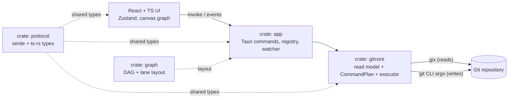

# GitGotten

A cross-platform, Rust-based visual Git manager. Simple enough that a user does not need
to know Git, yet fully transparent — every operation shows the exact Git command it runs.
Built for multiple repositories and full worktree support, with an interactive branching
graph at its core. Inspired by GitKraken.

GitGotten is a **Tauri v2** desktop app: a React + TypeScript UI over a Rust core that
reads with [`gix`](https://github.com/GitoxideLabs/gitoxide) and writes with the real
`git` CLI.

> Status: **in build — stages 0–10 of 15 complete, stage 11 next.** There is no release
> yet. See [Status](#status) below, [`PLAN.md`](./PLAN.md) for the stage plan, and
> [`SPEC.md`](./SPEC.md) for the full product design.

---

## Why it exists

- **Zero Git knowledge required.** Everyday Git tasks (commit, push, switch branches,
  merge, review history) without typing a command.
- **Total transparency.** Every mutating action compiles to a `CommandPlan` containing
  the literal `git` argv; the UI previews it before running, and the activity log records
  the command, exit code, output, and duration. The app never runs a write it cannot show.
- **The graph is the product.** A lane-based DAG rendered on canvas: lanes, merge edges,
  refs, search, follow-HEAD, context actions.
- **Safe failure.** A failed command surfaces its exact output and rolls UI state back; no
  silent half-states. Destructive operations are gated by a type-to-confirm dialog.

## Status

As of **2026-10-29** (`stage-10`). Stage numbers match [`PLAN.md`](./PLAN.md).

| Stage | Area | State |
|---|---|---|
| 0 | Workspace + Tauri/React scaffold | ✅ committed |
| 1 | `gix` read model: open repo, live status | ✅ committed |
| 2 | `CommandPlan` + git executor + activity log + preview/confirm | ✅ committed |
| 3 | Commit DAG + lane layout (pure Rust) | ✅ committed |
| 4 | Canvas graph: render, pan/zoom, select, context menu, search | ✅ committed |
| 5 | Per-hunk staging, commit/amend, discard | ✅ committed |
| 6 | Branches, remotes, tags | ✅ committed |
| 7 | Sync: fetch / pull / pull --rebase / push; merge | ✅ committed |
| 8 | Conflicts: 3-way view, resolve, continue/abort, `$EDITOR` hand-off | ✅ committed |
| 9 | Interactive rebase + cherry-pick | ✅ committed |
| 10 | Worktrees: list / add / switch / remove + graph checkout markers | ✅ committed |
| 11 | Stash, submodules, bisect | ⬜ not started |
| 12 | Multi-repo workspace (groups, dashboard), persistence, theming | ⬜ not started |
| 13 | Hardening: performance + reliability | ⬜ not started |
| 14 | Distribution: packaging, signing, auto-updater | ⬜ not started (unsigned `.msi` builds work) |

**Verification (macOS 25.6, arm64, 2026-10-29):**

- `cargo test --workspace` — 304 passed.
- `pnpm test` — 109 passed (11 files).
- `pnpm build` — TypeScript + Vite production build passes.
- Stage-09 flows (reorder / squash / reword / fixup / drop, `edit` pause + Continue,
  mid-rebase conflict → resolve → complete, cherry-pick onto a branch (clean +
  conflicting), published-history Danger gate) run against real `git` in fixture tests.
- Stage-10 flows (list main + linked + detached, add for an existing branch and with a
  new branch, double-checkout refused by git as a clean error, clean remove, dirty
  remove refused without force, force-remove as Dangerous type-to-confirm, switching
  retargets status/graph, per-worktree graph markers) run against real `git` in
  fixture tests.

**Verification (Windows 11, x64, 2026-10-27):**

- `cargo test --workspace` — 267 passed.
- `pnpm test` — 88 passed (9 files).
- `pnpm build` — TypeScript + Vite production build passes.
- `tauri build` — release binary built; unsigned MSI produced.
- App launched and was driven end-to-end: opened a repo, live status, per-file staging,
  `git add`/`git commit` through the preview dialog, external merge conflict detected via
  the watcher, conflict resolved in-app, `git merge --continue`, and
  `git push -u origin main` to a local bare remote.

Stages 09–10 have not been mirrored on Windows yet; the run above predates them.

## Features implemented today

**Repository & status**

- Open local repositories by path; repository registry with nested-path matching.
- Live status: branch, detached state, ahead/behind, staged/unstaged/untracked/conflicted
  changes, in-progress merge/rebase/cherry-pick state; file-watcher driven refresh
  (debounced via `notify`).

**Graph**

- Branch/commit DAG built with `gix`, laid out into lanes, rendered on HTML canvas.
- Zoom/pan, click-to-inspect, hover, search filter, follow-HEAD, late-mount sizing.
- Context actions: create branch at commit, reset (soft/mixed/hard), cherry-pick onto a
  chosen branch.

**Staging & commits**

- Per-hunk and per-file staging via `git apply --cached` (patch on stdin), unstage,
  discard; commit and amend; author override and co-authors.
- Conventional-commit quick prefixes, live command hints, preview/confirm for mutating ops.

**Refs & sync**

- Branches: create, switch, rename, delete, set/unset upstream.
- Remotes: add, remove, fetch.
- Tags: create (annotated/lightweight), checkout, delete, push.
- Fetch, pull, pull `--rebase`, push (with `-u` when needed); merge always `--no-ff`.
- Ahead/behind-aware sync buttons; exact-command previews.

**Conflicts (merge, rebase-stop, cherry-pick-stop)**

- Persistent banner with "k of N resolved", Continue, Abort, Open in editor.
- 3-way combined view (base/ours/theirs regions) plus a sides view and whole-file
  "take our/their version".
- Per-region resolutions: ours, theirs, both, or manual text; applies a patch and stages it.
- External editor resolved from `core.editor` → `$VISUAL` → `$EDITOR` → `vi`.

**Rebase**

- Interactive rebase dialog: reorder commits (drag or ↑/↓), squash / fixup / reword (with a
  message editor), drop, and an `edit` pause that resumes through Continue. The todo is
  prepared and run non-interactively via `GIT_SEQUENCE_EDITOR`, so the preview shows the
  exact todo the rebase executes.
- Rebase onto any branch from the Branches tab; the dialog defaults onto the current
  branch's upstream.
- Rebasing commits already on a remote is `Dangerous`: type-to-confirm with a
  "rewrites N commits on a remote" warning.

**Worktrees**

- List every checkout of a repo (branch or detached commit, path, main/current/locked/
  prunable); add a worktree for an existing branch, a specific commit, or a new branch;
  remove (clean) or force-remove (Dangerous: type-to-confirm, names the lost work).
- TopBar worktree switcher and a Worktrees tab; switching opens that worktree root as the
  active repository, so status, graph, and every op retarget to it. The graph pins each
  worktree's checkout with an outlined marker on the commit it looks at.
- Checking a branch out in two worktrees is refused by git and surfaced as a clean error.

## Not implemented yet

Stash, submodules, bisect;
multi-repo groups, pinned/reordered repos, cross-repo dashboard; persisted workspace config
(`%APPDATA%\GitGotten` / macOS config dir); light/dark theming and the full design system;
performance hardening on very large repositories; Windows/macOS signing, notarization, and
the auto-updater.

Linux is deferred (the architecture stays portable).

## Architecture



| Crate / package | Responsibility |
|---|---|
| `crates/protocol` | Shared Rust ⇄ TypeScript types (`Op`, `CommandPlan`, `Status`, `Graph`, conflict types), serialized by serde and generated to TS with `ts-rs`. |
| `crates/gitcore` | `gix` read model (open, status, log/graph, refs, diffs, conflicts), the `Op` → `CommandPlan` compiler, and the async executor that runs argv vectors against the real `git` binary. |
| `crates/graph` | Pure DAG construction and lane layout, plus an SVG debug renderer and oracle tests. |
| `crates/app` | Tauri v2 shell: commands, backend state/registry, op queue, activity log, file watcher. |
| `crates/testutil` | Dev-only real-git fixtures: temp repos, bare remotes, deterministic dates. |
| `src/` | Web UI (`git-gotten-web`): React 18, TypeScript, Vite, Zustand, Vitest. |

**Layout**

```
git-gotten/
  Cargo.toml                 # Rust workspace
  package.json               # root: @tauri-apps/cli + scripts
  SPEC.md  PLAN.md  README.md
  crates/
    protocol/ graph/ gitcore/ app/ testutil/
  src/                       # Vite root for the web UI
    package.json  vite.config.ts  index.html
    src/                     # React app, components, store, tests, styles
  crates/app/tauri.conf.json # Tauri config (productName GitGotten, identifier com.sivartydrup.gitgotten)
```

### The transparency invariant

Every write is an `Op` (e.g. `StageHunks`, `Merge`, `ResolveConflict`). `gitcore::plan`
turns it into a `CommandPlan`:

- `display` — the exact command string shown to the user;
- `steps` — argv vectors (never shell strings) plus summaries and effects;
- `risk` — `Read` / `Mutating` / `Dangerous`;
- `preview` — headline, effect lines, and type-to-confirm for dangerous operations.

The UI previews mutating plans, runs them through the app's per-repo queue, and appends
the command, exit code, stdout/stderr, duration, and conflict handoff to the activity log.

## Getting started

### Prerequisites

| Platform | Requirements |
|---|---|
| All | Rust stable (`rustup`), Node LTS + `pnpm`, Git on `PATH`, `pnpm add -D @tauri-apps/cli` (installed via `pnpm install`) |
| macOS | Xcode Command Line Tools. Primary dev/test platform. |
| Windows | **Visual Studio 2022 Build Tools** with *Desktop development with C++* (MSVC + Windows SDK), **WebView2 runtime** (preinstalled on Windows 11 / current Windows 10), Rust's MSVC toolchain (`stable-x86_64-pc-windows-msvc`). Rust must be on `PATH` (`%USERPROFILE%\.cargo\bin`). |

Verified working set (2026-10-27): Rust 1.99.1 MSVC · VS Build Tools 17.14.42 ·
Windows SDK 10.0.26100 · WebView2 155.x · Node 24.22.1 · pnpm 10.34.9 · Git 2.56.0.

### Install, run, build

Run from the repository root:

```bash
pnpm install          # root: Tauri CLI
pnpm --dir src install
pnpm tauri:dev        # dev window (Vite on :1420)
pnpm tauri:build      # release build (per tauri.conf.json bundle targets)
cargo run -p git-gotten-app   # dev run; needs the Vite dev server on :1420
```

Windows installer:

```bash
pnpm tauri:build -- --bundles msi
# -> target/release/bundle/msi/GitGotten_0.1.0_x64_en-US.msi
```

The release executable is `target/release/git-gotten-app.exe` on Windows. Bundles are
unsigned; signing is gated on infrastructure that does not exist yet (Stage 14).

### Tests

```bash
cargo test                  # Rust: 267 tests (unit + integration + real-git fixtures)
pnpm test                   # Web: 88 tests (Vitest + Testing Library)
pnpm build                  # tsc + Vite production build
```

Test strategy:

- **Real repositories, not mocks.** `crates/testutil` creates temporary repos with the real
  `git` binary; fixtures cover staging, refs, sync, and conflicts.
- **Graph oracle.** `crates/graph` layout is checked against `git log --graph` output on
  real histories, plus deterministic commit dates.
- **Command plans as contracts.** Tests assert the exact argv/display for every `Op`.
- **UI behavior.** Component tests drive the real stores against a mocked IPC layer;
  the Rust backend is exercised separately.

## Windows notes

Discovered while getting the first Windows build green:

- Local test remotes must be plain absolute paths; `git` misparses a `\\?\C:\…` verbatim
  path as an SCP-style `host:path` remote ("hostname contains invalid characters").
  `testutil` strips the prefix for remote URLs.
- The fixture's no-op `core.editor` is `git --version`, not Unix's `true` (there is no
  `true.exe`); the app resolves editors by spawning argv directly.
- Pass a relative patch path to `git apply` in tests; an absolute verbatim path is taken
  for a remote too.
- The Tauri CLI must be able to find `cargo` on `PATH`; rustc finds MSVC/SDK from the
  registry, so a Developer Command Prompt is not required.

## Documentation

| File | Purpose |
|---|---|
| [`SPEC.md`](./SPEC.md) | Product design and decisions — the source of truth for behavior and scope. |
| [`PLAN.md`](./PLAN.md) | 15-stage implementation plan, per-stage acceptance criteria, platform gates, and build workflow. |
| `README.md` | This overview: what exists today, how to build/test, and where the project is. |

Per-stage workflow from `PLAN.md`: write failing tests → implement → `cargo test` +
`pnpm test` + `pnpm build` + `tauri build` → hand-verify → commit → push. Commit messages
are `stage-NN: <kebab-summary>`.

## License

MIT (see `Cargo.toml`; a license file has not been added yet).
