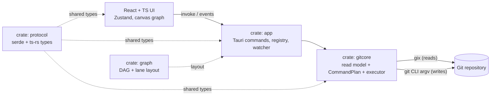

# GitGotten

A cross-platform, Rust-based visual Git manager. Simple enough that a user does not need
to know Git, yet fully transparent — every operation shows the exact Git command it runs.
Built for multiple repositories and full worktree support, with an interactive branching
graph at its core. Inspired by GitKraken.

GitGotten is a **Tauri v2** desktop app: a React + TypeScript UI over a Rust core that
reads with [`gix`](https://github.com/GitoxideLabs/gitoxide) and writes with the real
`git` CLI.

> Status: **all 15 stages (0–14) are committed.** The app builds, bundles, installs and
> self-updates locally — but nothing is published yet: no signed release exists. See
> [Status](#status), [`PLAN.md`](./PLAN.md) and [`SPEC.md`](./SPEC.md).

---

## Why it exists

- **Zero Git knowledge required.** Everyday Git tasks (commit, push, switch branches,
  merge, review history) without typing a command.
- **Total transparency.** Every mutating action compiles to a `CommandPlan` containing
  the literal `git` argv; the UI previews it before running, and the activity log records
  the command, exit code, output, and duration. The app never runs a write it cannot show.
- **The graph is the product.** A lane-based DAG rendered on canvas: lanes, merge edges,
  refs, search, follow-HEAD, context actions.
- **Safe failure.** A failed command surfaces its exact output and rolls UI state back; no
  silent half-states. Destructive operations are gated by a type-to-confirm dialog.

## Status

As of **2026-10-29** (`stage-10`). Stage numbers match [`PLAN.md`](./PLAN.md).

| Stage | Area | State |
|---|---|---|
| 0 | Workspace + Tauri/React scaffold | ✅ committed |
| 1 | `gix` read model: open repo, live status | ✅ committed |
| 2 | `CommandPlan` + git executor + activity log + preview/confirm | ✅ committed |
| 3 | Commit DAG + lane layout (pure Rust) | ✅ committed |
| 4 | Canvas graph: render, pan/zoom, select, context menu, search | ✅ committed |
| 5 | Per-hunk staging, commit/amend, discard | ✅ committed |
| 6 | Branches, remotes, tags | ✅ committed |
| 7 | Sync: fetch / pull / pull --rebase / push; merge | ✅ committed |
| 8 | Conflicts: 3-way view, resolve, continue/abort, `$EDITOR` hand-off | ✅ committed |
| 9 | Interactive rebase + cherry-pick | ✅ committed |
| 10 | Worktrees: list / add / switch / remove + graph checkout markers | ✅ committed |
| 11 | Stash, submodules, bisect | ✅ committed |
| 12 | Multi-repo workspace (groups, dashboard), persistence, theming | ✅ committed |
| 13 | Hardening: performance + reliability | ✅ committed |
| 14 | Distribution: packaging, signing, auto-updater | ✅ committed (signing/notarization infra missing) |

**Verification (macOS 25.6, arm64, 2026-10-29):**

- `cargo test --workspace` — 304 passed.
- `pnpm test` — 109 passed (11 files).
- `pnpm build` — TypeScript + Vite production build passes.
- Stage-09 flows (reorder / squash / reword / fixup / drop, `edit` pause + Continue,
  mid-rebase conflict → resolve → complete, cherry-pick onto a branch (clean +
  conflicting), published-history Danger gate) run against real `git` in fixture tests.
- Stage-10 flows (list main + linked + detached, add for an existing branch and with a
  new branch, double-checkout refused by git as a clean error, clean remove, dirty
  remove refused without force, force-remove as Dangerous type-to-confirm, switching
  retargets status/graph, per-worktree graph markers) run against real `git` in
  fixture tests.

**Verification (macOS 25.6, arm64, 2026-11-02):**

- `cargo test --workspace` — 349 passed (includes the new workspace-tree tests:
  `app.json` round-trip across simulated restarts, corrupt-file recovery, group
  ops, pin/remove persistence, reopen-on-startup).
- `pnpm test` — 165 passed (16 files).
- `pnpm build` — TypeScript + Vite production build passes.
- `tauri build` — `GitGotten.app` bundle produced.
- Stage-12 flows driven headlessly in Chromium against the production bundle:
  nested groups with pinned-first ordering, `+ group` add, group delete hoisting
  children, pin reorder, search filter, remove-from-workspace, the
  All-Repositories dashboard (live branch/state/ahead-behind/dirty/last-commit
  per repo, row click switches the active repo), Light/Dark recoloring the chrome
  and swapping the canvas lane palette, and theme persistence across reload.
- Windows gate was not run at that time; later Windows verification is recorded below.
  The observed workspace path is `%APPDATA%\com.sivartydrup.gitgotten\app.json`.

**Verification (macOS 25.6, arm64, 2026-11-04):**

- `cargo test --workspace` — 368 passed, in both debug **and** release profiles, no warnings.
- `pnpm test` — 189 passed (17 files). `pnpm build` — production build passes.
- Stage-13 performance on a 10 120-commit synthetic repository (`--release`): the app's
  graph pipeline builds DAG + lane layout cold in 116–121 ms (SPEC §18 budget 300 ms),
  replays it from the per-repo cache in 3 ms, and rebuilds it in ~90 ms after one commit
  moves the fingerprint. Layout threshold asserted in both profiles.
- Canvas culling at 10 000 graph rows: the visible window stays under 100 rows at every
  pan position and at both zoom bounds, a full `renderGraph` pass issues under 2 000
  canvas calls and finishes in well under 500 ms — a culling regression fails the test,
  it does not merely slow down. The subjective 60 fps check was not done by hand.
- Stage-13 concurrency, against real `git`: 24 concurrent mutating ops (commits, branch
  and tag creates, stash pushes) on one repository all land with exactly the implied
  history and zero lock diagnostics; 8 good ops survive 9 colliding neighbours that all
  fail with non-zero exits; 12 ops fired from a main checkout *and* a linked worktree
  serialize on one turn (same queue key = the common git dir); ops on two repositories
  measurably overlap; `run_plans` keeps a compound flow atomic against 12 interleaving
  `git reset -q` attempts.
- Stage-13 failure paths, against real `git`: a failing middle step stops the rest of its
  plan and carries git's own stderr verbatim; an interrupted mid-merge stays a
  recoverable merge with `git merge --continue` refusing until the conflict is really
  resolved; a push to a dead remote fails cleanly with no remote-tracking ref written;
  a commit message full of shell metacharacters (plus a file named `-rf`) never reaches a
  shell. Friendly git-error text renders *above* the raw command + output, and every
  panel re-reads live state when an op finishes.
- Per-repo activity log: bounded 500-entry ring mirrored to one JSON file per repository,
  restored on restart with monotonic ids, rebuilt from a deliberately corrupted file;
  `Backend` restart recovers workspace and log.
- Windows gate: not run — no Windows machine available. The new paths are plain `std::fs`
  over the OS-aware app-data dir already covered by the persistence round-trip tests.

**Verification (macOS 25.6, arm64, 2026-11-04 — stage 14):**

- `cargo test` — 375 passed, including 7 new updater integration tests in
  `crates/app/tests/updater.rs`. `pnpm test` — 198 passed (18 files). `pnpm build` —
  TypeScript + Vite production build passes.
- Update decisions are exercised against a **real local HTTP feed**, not a mock: a feed
  announcing 9.9.9 yields an update whose version, notes and download URL are the entry
  for *this* os-arch; a feed announcing the running version (or an older one) yields none;
  a feed with no endpoints fails loudly instead of silently; a manifest signed with a
  placeholder signature is rejected against the pinned pubkey. The published manifest
  template (`updater/latest.json`) is parsed by the plugin's own schema type in a test.
- `tauri build` with no signing environment set: exit 0, `GitGotten.app` (7.65 MiB) and
  `GitGotten_0.1.0_aarch64.dmg` (3.93 MiB) under `target/release/bundle`.
- The `.dmg` was mounted, `GitGotten.app` copied out and launched: the window renders, and
  the launch-time feed check fired (two `GET /latest.json` hits in the mock feed's access
  log, 8 s apart) and the prompt appeared on screen — "Update available: **9.9.9**" with
  the manifest's release notes and Install / Dismiss buttons.
- Not verified at that time: the Install path end to end (download → signature check →
  install → relaunch) needs a real signed artifact. Windows MSI verification is below.

**Verification (Windows 11, x64, 2026-10-27):**

- `cargo test --workspace` — 267 passed.
- `pnpm test` — 88 passed (9 files).
- `pnpm build` — TypeScript + Vite production build passes.
- `tauri build` — release binary built; unsigned MSI produced.
- App launched and was driven end-to-end: opened a repo, live status, per-file staging,
  `git add`/`git commit` through the preview dialog, external merge conflict detected via
  the watcher, conflict resolved in-app, `git merge --continue`, and
  `git push -u origin main` to a local bare remote.

**Verification (Windows 11, x64, 2026-11-04):**

- `cargo test --workspace --no-fail-fast` — 380 passed, including updater integration
  tests, bisect, interactive rebase, submodules, and worktrees.
- Node 26.13.0 / pnpm 10.34.9: `pnpm test` — 205 passed; `pnpm build` — passed.
- The unsigned MSI was built, installed with administrator elevation, and launched.
  In the installed app, worktrees with spaces in their paths were switched to and
  removed, including a dirty force-removal. Successful removals disappear from
  `app.json` and the nav after restart; failed removals preserve workspace entries.
  Two repositories, a group and the dark theme survived restart. Workspace data was
  observed at `%APPDATA%\com.sivartydrup.gitgotten\app.json`; the theme is stored by
  WebView2.
- A 10,120-commit synthetic repository opened and rendered; automated drag and zoom
  each yielded about 60 `requestAnimationFrame` callbacks per second, p95 16.8 ms,
  with no interval over 33.4 ms (4 s drag; 3 s zoom). This measures callback
  scheduling, not presented-frame timing. A rejected double checkout showed Git's
  error in the activity log, and the graph remained usable.
  The installed UI bisected a six-commit history to its known first bad commit, reset
  the session, initialized a submodule, and restored a drifted submodule checkout.
- A local feed offered a real updater-signed Windows MSI to an installed 0.1.0 test
  build. Install downloaded and verified the signed payload, upgraded it to 0.1.1,
  and relaunched the app at 0.1.1. The test versions and feed were local only; no
  signed release is published, and the configured GitHub release feed returns 404.
  The test key was exposed on a guest-readable share and must be rotated before release.
  Windows Authenticode signing and macOS signing/notarization remain unverified.
- Git 2.56's bisect result format, Windows rebase editor paths, inherited sequence-editor
  overrides, submodule fixture paths, Node's storage globals, and the updater test
  executable's Windows manifest were corrected during this verification. A real
  interactive rebase through the app dropped the chosen commit.
- Successful worktree removals now unlink registered checkouts from the persisted
  workspace; failed removals retain them. Files-panel hooks now remain stable when
  status loads asynchronously, avoiding a blank window when opening the tab early.

## Features implemented today

**Repository & status**

- Open local repositories by path; repository registry with nested-path matching.
- Live status: branch, detached state, ahead/behind, staged/unstaged/untracked/conflicted
  changes, in-progress merge/rebase/cherry-pick state; file-watcher driven refresh
  (debounced via `notify`).

**Graph**

- Branch/commit DAG built with `gix`, laid out into lanes, rendered on HTML canvas.
- Zoom/pan, click-to-inspect, hover, search filter, follow-HEAD, late-mount sizing.
- Context actions: create branch at commit, reset (soft/mixed/hard), cherry-pick onto a
  chosen branch.

**Staging & commits**

- Per-hunk and per-file staging via `git apply --cached` (patch on stdin), unstage,
  discard; commit and amend; author override and co-authors.
- Conventional-commit quick prefixes, live command hints, preview/confirm for mutating ops.

**Refs & sync**

- Branches: create, switch, rename, delete, set/unset upstream.
- Remotes: add, remove, fetch.
- Tags: create (annotated/lightweight), checkout, delete, push.
- Fetch, pull, pull `--rebase`, push (with `-u` when needed); merge always `--no-ff`.
- Ahead/behind-aware sync buttons; exact-command previews.

**Conflicts (merge, rebase-stop, cherry-pick-stop)**

- Persistent banner with "k of N resolved", Continue, Abort, Open in editor.
- 3-way combined view (base/ours/theirs regions) plus a sides view and whole-file
  "take our/their version".
- Per-region resolutions: ours, theirs, both, or manual text; applies a patch and stages it.
- External editor resolved from `core.editor` → `$VISUAL` → `$EDITOR` → `vi`.

**Rebase**

- Interactive rebase dialog: reorder commits (drag or ↑/↓), squash / fixup / reword (with a
  message editor), drop, and an `edit` pause that resumes through Continue. The todo is
  prepared and run non-interactively via `GIT_SEQUENCE_EDITOR`, so the preview shows the
  exact todo the rebase executes.
- Rebase onto any branch from the Branches tab; the dialog defaults onto the current
  branch's upstream.
- Rebasing commits already on a remote is `Dangerous`: type-to-confirm with a
  "rewrites N commits on a remote" warning.

**Worktrees**

- List every checkout of a repo (branch or detached commit, path, main/current/locked/
  prunable); add a worktree for an existing branch, a specific commit, or a new branch;
  remove (clean) or force-remove (Dangerous: type-to-confirm, names the lost work).
- TopBar worktree switcher and a Worktrees tab; switching opens that worktree root as the
  active repository, so status, graph, and every op retarget to it. The graph pins each
  worktree's checkout with an outlined marker on the commit it looks at.
- Checking a branch out in two worktrees is refused by git and surfaced as a clean error.

**Stash, submodules & bisect**

- Stash push/list/apply/drop; submodule list/sync/update; git bisect run helper
  with a live panel (good/bad marking, remaining count, culprit found).

**Workspace & theming**

- Nested repo groups with drag-and-drop reorder, pinning (pinned repos top of
  their group), recents ordering, search, and remove-from-workspace (never
  touches disk) — persisted to `app.json` in the OS config dir and re-opened
  at startup.
- All-Repositories dashboard: sortable/filterable live status for every open
  repo; row click switches repos.
- Light + Dark + system-follow theming (persisted), applied to the chrome and
  the branch-lane palette on the graph canvas.

**Performance & reliability (stage 13)**

- The commit graph is cached per open repository, keyed on a fingerprint of every ref
  target, `HEAD` and each worktree's recorded HEAD: browsing, staging and editing
  replay the cached layout (3 ms), while a commit, a ref move, a checkout or a
  worktree change rebuilds it — 116 ms for a 10 120-commit repository, inside the
  300 ms SPEC §18 budget.
- The canvas draws only the visible window of rows plus a margin at every pan and
  zoom level, with a bounded draw-call count at 10 000 rows.
- Ops on a repository serialize against its **common git dir** (so linked worktrees of
  one object database share a turn); 24 concurrent ref-writing ops on one repo all
  land with no `index.lock`/ref-lock error. A compound flow (a bisect test and the
  verdict it decides) holds one turn end to end.
- A failing step stops the rest of its plan and returns git's own output verbatim; a
  mid-op interruption leaves a recoverable state (an interrupted merge stays a
  merge). The web never guesses: every panel re-reads from Rust on `op_finished`, and
  friendly git messages render *above* the raw command + output, never instead of it.
- The activity log is per-repository state — a bounded 500-entry ring mirrored to one
  JSON file per repo, restored on restart, monotonic ids, and rebuilt from scratch if
  the file is corrupt.

**Distribution & auto-update (stage 14)**

- `tauri build` bundles `.app` + `.dmg` on macOS and `.msi` on Windows from one config
  (`bundle.targets = "all"`), with the SPEC §17 floor pinned as
  `bundle.macOS.minimumSystemVersion = "12.0"`.
- The updater plugin is wired on both sides: Rust (`tauri_plugin_updater` +
  `tauri_plugin_process` in `crates/app/src/lib.rs`) and web (`checkForUpdate` /
  `installUpdate` in `api.ts`, an updater slice in `store.ts`, `components/UpdatePrompt.tsx`),
  with `updater:default` + `process:allow-restart` granted to the main window capability.
- Checks run once at launch and every 6 hours while the app is open, against the static
  GitHub Releases manifest
  `https://github.com/sivartydrup/git-gotten/releases/latest/download/latest.json`,
  verified against the minisign pubkey pinned in `tauri.conf.json`.
- An unreachable or unreadable feed is *not* an update: the failure reason is recorded and
  no prompt renders. When a newer release is announced, the prompt shows its version and
  release notes with Install / Dismiss; Install downloads, verifies the signature, installs
  and relaunches.

## Not implemented yet

macOS code signing + notarization, Windows Authenticode signing, and publishing the first
signed release (which is what makes the update feed live) — all gated on certificates and
CI that do not exist yet; the updater itself is implemented and verified against a mock
feed. The remaining per-repo state files (branch colors, last selection).

Linux is deferred (the architecture stays portable).

## Architecture



| Crate / package | Responsibility |
|---|---|
| `crates/protocol` | Shared Rust ⇄ TypeScript types (`Op`, `CommandPlan`, `Status`, `Graph`, conflict types), serialized by serde and generated to TS with `ts-rs`. |
| `crates/gitcore` | `gix` read model (open, status, log/graph, refs, diffs, conflicts), the `Op` → `CommandPlan` compiler, and the async executor that runs argv vectors against the real `git` binary. |
| `crates/graph` | Pure DAG construction and lane layout, plus an SVG debug renderer and oracle tests. |
| `crates/app` | Tauri v2 shell: commands, backend state/registry, op queue, activity log, file watcher. |
| `crates/testutil` | Dev-only real-git fixtures: temp repos, bare remotes, deterministic dates. |
| `src/` | Web UI (`git-gotten-web`): React 18, TypeScript, Vite, Zustand, Vitest. |

**Layout**

```
git-gotten/
  Cargo.toml                 # Rust workspace
  package.json               # root: @tauri-apps/cli + scripts
  SPEC.md  PLAN.md  README.md
  crates/
    protocol/ graph/ gitcore/ app/ testutil/
  src/                       # Vite root for the web UI
    package.json  vite.config.ts  index.html
    src/                     # React app, components, store, tests, styles
  crates/app/tauri.conf.json # Tauri config (productName GitGotten, identifier com.sivartydrup.gitgotten)
```

### The transparency invariant

Every write is an `Op` (e.g. `StageHunks`, `Merge`, `ResolveConflict`). `gitcore::plan`
turns it into a `CommandPlan`:

- `display` — the exact command string shown to the user;
- `steps` — argv vectors (never shell strings) plus summaries and effects;
- `risk` — `Read` / `Mutating` / `Dangerous`;
- `preview` — headline, effect lines, and type-to-confirm for dangerous operations.

The UI previews mutating plans, runs them through the app's per-repo queue, and appends
the command, exit code, stdout/stderr, duration, and conflict handoff to the activity log.

## Getting started

### Prerequisites

| Platform | Requirements |
|---|---|
| All | Rust stable (`rustup`), Node LTS + `pnpm`, Git on `PATH`, `pnpm add -D @tauri-apps/cli` (installed via `pnpm install`) |
| macOS | Xcode Command Line Tools. Primary dev/test platform. |
| Windows | **Visual Studio 2022 Build Tools** with *Desktop development with C++* (MSVC + Windows SDK), **WebView2 runtime** (preinstalled on Windows 11 / current Windows 10), Rust's MSVC toolchain (`stable-x86_64-pc-windows-msvc`). Rust must be on `PATH` (`%USERPROFILE%\.cargo\bin`). |

Verified working set (2026-10-27): Rust 1.99.1 MSVC · VS Build Tools 17.14.42 ·
Windows SDK 10.0.26100 · WebView2 155.x · Node 24.22.1 · pnpm 10.34.9 · Git 2.56.0.

### Install, run, build

Run from the repository root:

```bash
pnpm install          # root: Tauri CLI
pnpm --dir src install
pnpm tauri:dev        # dev window (Vite on :1420)
pnpm tauri:build      # release build (per tauri.conf.json bundle targets)
cargo run -p git-gotten-app   # dev run; needs the Vite dev server on :1420
```

Windows installer:

```bash
pnpm tauri:build --bundles msi
# -> target/release/bundle/msi/GitGotten_0.1.0_x64_en-US.msi
```

The release executable is `target/release/git-gotten-app.exe` on Windows. Bundles stay
unsigned today; see [Building, signing and updating](#building-signing-and-updating) for
what a signed release needs.

### Tests

```bash
cargo test                  # Rust: 375 tests (unit + integration + real-git fixtures)
pnpm test                   # Web: 198 tests (Vitest + Testing Library)
pnpm build                  # tsc + Vite production build
```

Test strategy:

- **Real repositories, not mocks.** `crates/testutil` creates temporary repos with the real
  `git` binary; fixtures cover staging, refs, sync, and conflicts.
- **Graph oracle.** `crates/graph` layout is checked against `git log --graph` output on
  real histories, plus deterministic commit dates.
- **Command plans as contracts.** Tests assert the exact argv/display for every `Op`.
- **UI behavior.** Component tests drive the real stores against a mocked IPC layer;
  the Rust backend is exercised separately.

## Building, signing and updating

**Unsigned local build** (what development does today):

```bash
pnpm tauri:build     # -> bundle/macos/GitGotten.app + bundle/dmg/GitGotten_<ver>_<arch>.dmg
```

`bundle.createUpdaterArtifacts = false` is what keeps this working with no signing key: an
unsigned build still produces an installer, and the installed app still checks the feed.

**Updater identity:** `pnpm tauri signer generate -- -w ~/.tauri/gitgotten.key` created the
minisign keypair. The public half is pinned in
`crates/app/tauri.conf.json → plugins.updater.pubkey`; the private key stays out of the
repo. The feed is GitHub Releases' static manifest (`…/releases/latest/download/latest.json`)
and `updater/latest.json` is that manifest's template — the same shape the app's manifest
test parses.

**A signed release** adds, at build time:

| Gate | What it needs |
|---|---|
| Signed updater artifacts + `latest.json` | `TAURI_SIGNING_PRIVATE_KEY`, `TAURI_SIGNING_PRIVATE_KEY_PASSWORD`, and an override file setting `bundle.createUpdaterArtifacts` to `true`; produces `GitGotten_<ver>_<arch>.app.tar.gz` + `.sig` on macOS or `.msi` + `.sig` on Windows |
| macOS code signing | `APPLE_CERTIFICATE`, `APPLE_CERTIFICATE_PASSWORD`, `APPLE_SIGNING_IDENTITY` (hardened runtime is on by default) |
| macOS notarization | `APPLE_ID` + `APPLE_PASSWORD` + `APPLE_TEAM_ID`, or `APPLE_API_KEY` + `APPLE_API_ISSUER`; `APPLE_PROVIDER_SHORT_NAME` when the account spans teams |
| Windows code signing | an Authenticode certificate plus `TAURI_WINDOWS_SIGNTOOL_PATH` / `bundle.windows.signCommand` |

`--config` accepts a file path or a JSON string. Pointing a build at a mock feed is done
with an override file setting `plugins.updater.endpoints` and
`dangerousInsecureTransportProtocol`, never a committed config value or a code path.

The Windows-side runbook — getting the updater key onto that machine, building signed
artifacts, filling in `latest.json`, and proving the Install flow against a local feed — is
[`WINDOWS-SIGNING.md`](./WINDOWS-SIGNING.md).

## Windows notes

Discovered while getting the first Windows build green:

- Local test remotes must be plain absolute paths; `git` misparses a `\\?\C:\…` verbatim
  path as an SCP-style `host:path` remote ("hostname contains invalid characters").
  `testutil` strips the prefix for remote URLs.
- The fixture's no-op `core.editor` is `git --version`, not Unix's `true` (there is no
  `true.exe`); the app resolves editors by spawning argv directly.
- Pass a relative patch path to `git apply` in tests; an absolute verbatim path is taken
  for a remote too.
- The Tauri CLI must be able to find `cargo` on `PATH`; rustc finds MSVC/SDK from the
  registry, so a Developer Command Prompt is not required.

## Documentation

| File | Purpose |
|---|---|
| [`SPEC.md`](./SPEC.md) | Product design and decisions — the source of truth for behavior and scope. |
| [`PLAN.md`](./PLAN.md) | 15-stage implementation plan, per-stage acceptance criteria, platform gates, and build workflow. |
| `README.md` | This overview: what exists today, how to build/test, and where the project is. |
| [`WINDOWS-SIGNING.md`](./WINDOWS-SIGNING.md) | Windows runbook for the stage-14 signing + updater verification steps. |

Per-stage workflow from `PLAN.md`: write failing tests → implement → `cargo test` +
`pnpm test` + `pnpm build` + `tauri build` → hand-verify → commit → push. Commit messages
are `stage-NN: <kebab-summary>`.

## License

MIT (see `Cargo.toml`; a license file has not been added yet).
