<p align="center">
  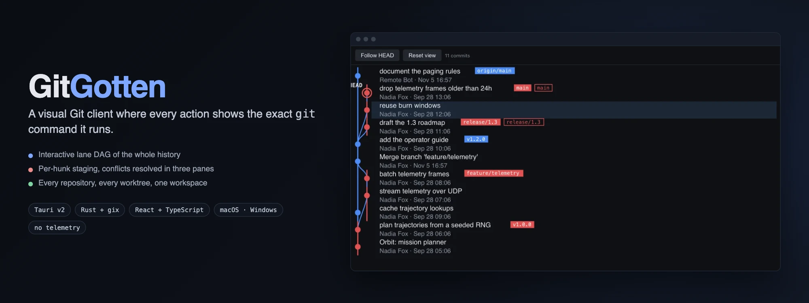
</p>

<p align="center">
  <a href="https://github.com/sivartydrup/git-gotten/actions/workflows/ci.yml">
    </a>
  
  
  
  
  
</p>

**GitGotten** is a native Git client for macOS and Windows — Tauri v2 shell, Rust core
(`gix` for reads, the real `git` CLI for writes), React + TypeScript UI, an interactive lane
DAG as its centerpiece, and one rule that shapes everything:

> **Every button shows the exact `git` command it is about to run — and what it will change
> — before you click, and its real output after.**

Open a repository and the graph appears. Staging, branch switches, sync, rebase todo lists,
conflict patches: all planned as argv vectors, previewed, then executed against your `git`
with your `.gitconfig`. Nothing is hidden, nothing is invented.

---

## Why it exists

- **Zero Git knowledge required.** Everyday Git tasks (commit, push, switch branches,
  stash, resolve a conflict, bisect) should be pointable, not remembered.
- **But it must stay honest about Git.** A GUI that hides Git teaches nothing. GitGotten
  shows the exact command behind every action, before you run it and in the activity log
  after. You learn Git *by using* GitGotten: the UI is the abstraction, the command panel is
  the textbook.
- **Built-in auto-update** so it stays current.
- **Safe failure.** A failed command surfaces its exact output and rolls UI state back; no
  silent half-states. Destructive operations are gated by a type-to-confirm dialog.

## Screens

All captured from the production web bundle driven in headless Chromium against the
stage fixtures (`cargo test -p git-gotten-app --test docs_fixtures -- --ignored`).

| The commit graph: lanes, branch pills, tags, HEAD | Per-hunk staging with the exact `git apply` plan |
|---|---|
| 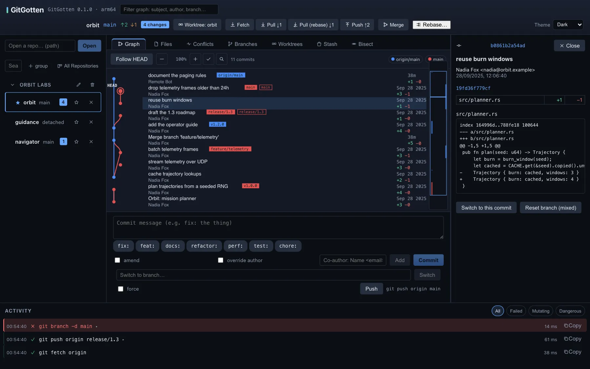 | 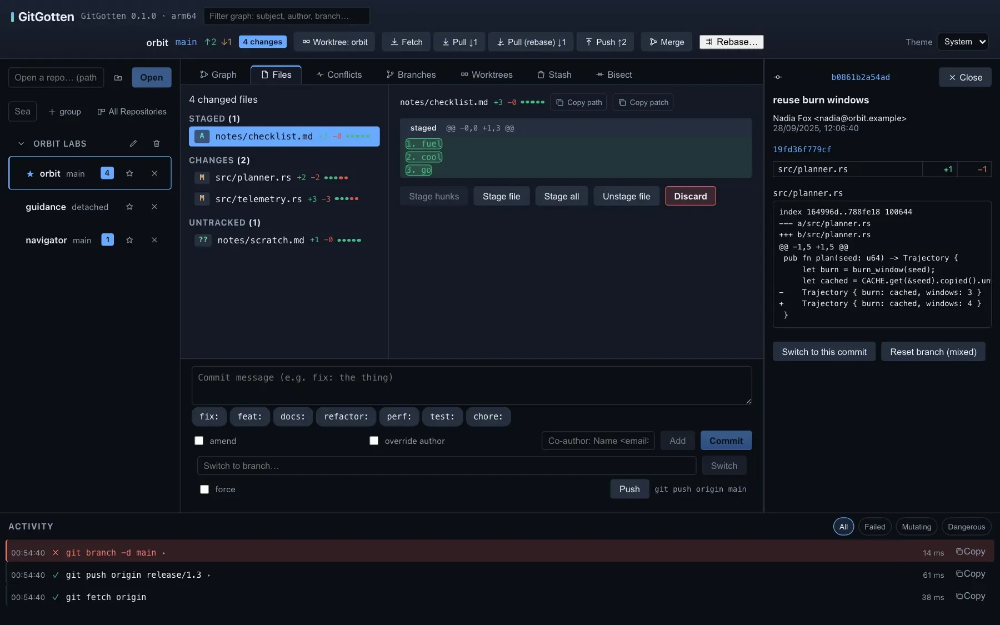 |
| Branches, remotes and tags | Three-pane conflict resolution (base / ours / theirs) |
| 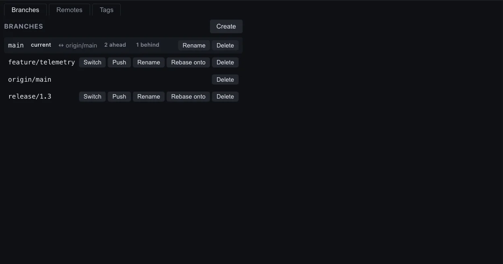 | 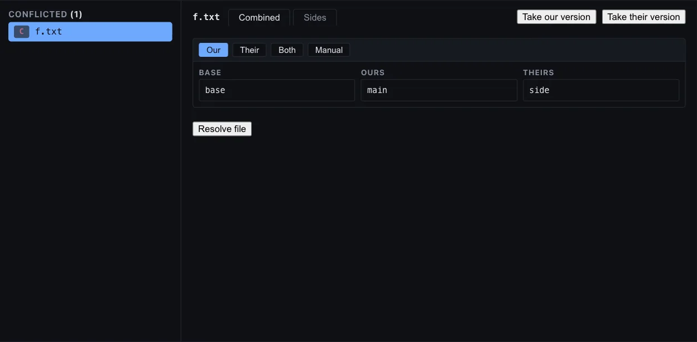 |
| All-repositories dashboard | Worktrees: every checkout of a repo |
| 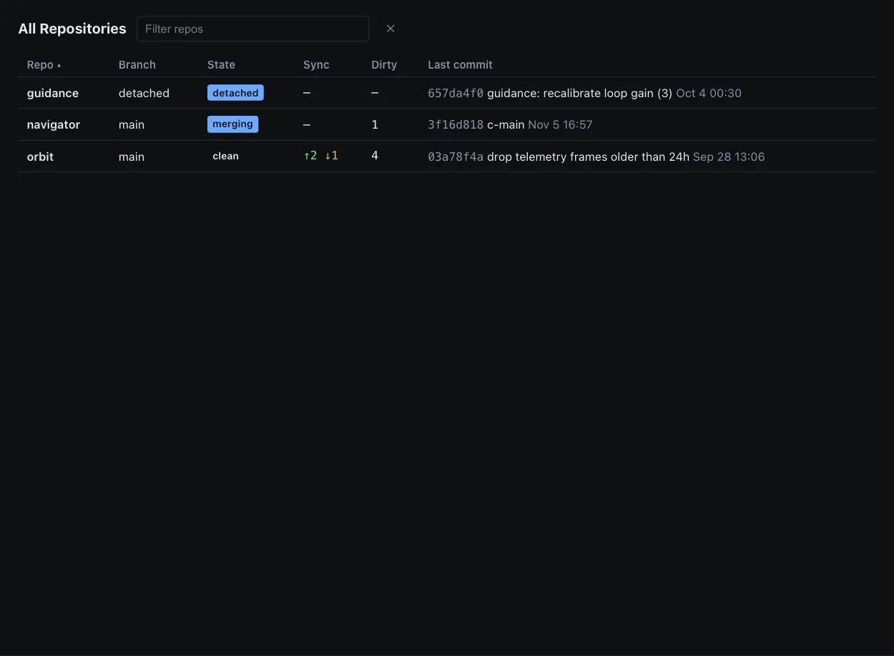 | 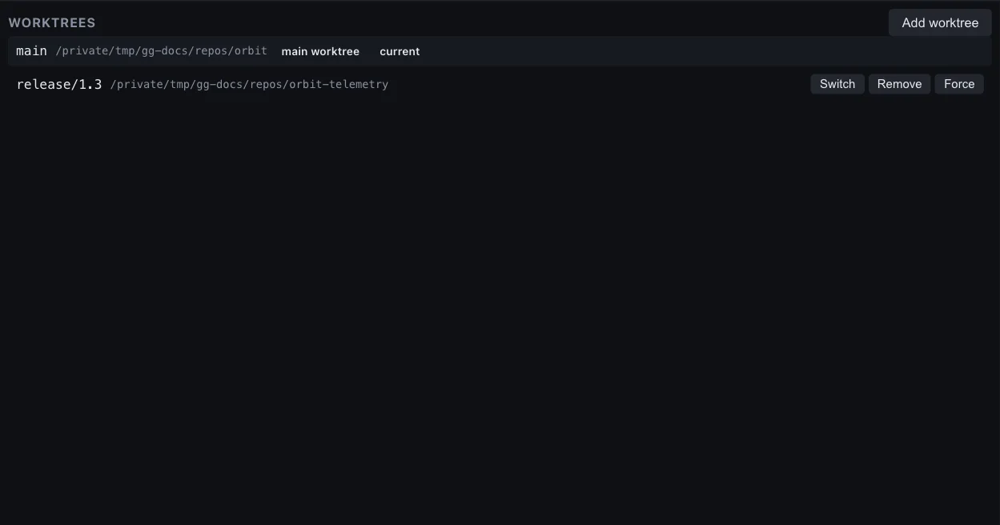 |
| `git bisect run` panel | Update prompt from the release manifest |
| 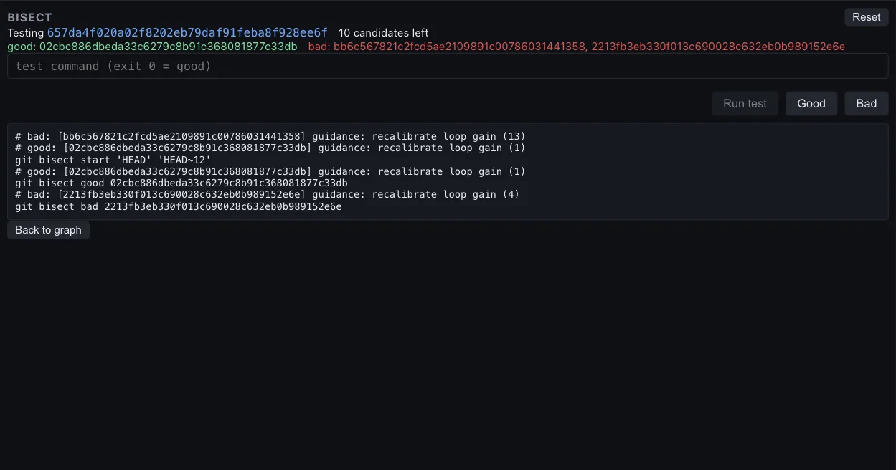 | 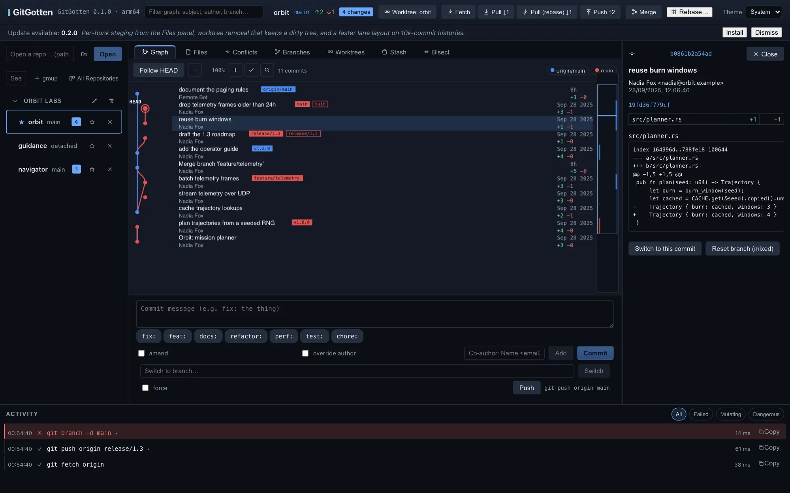 |
| ⌘K palette: the row shows the exact command it will run | |
| 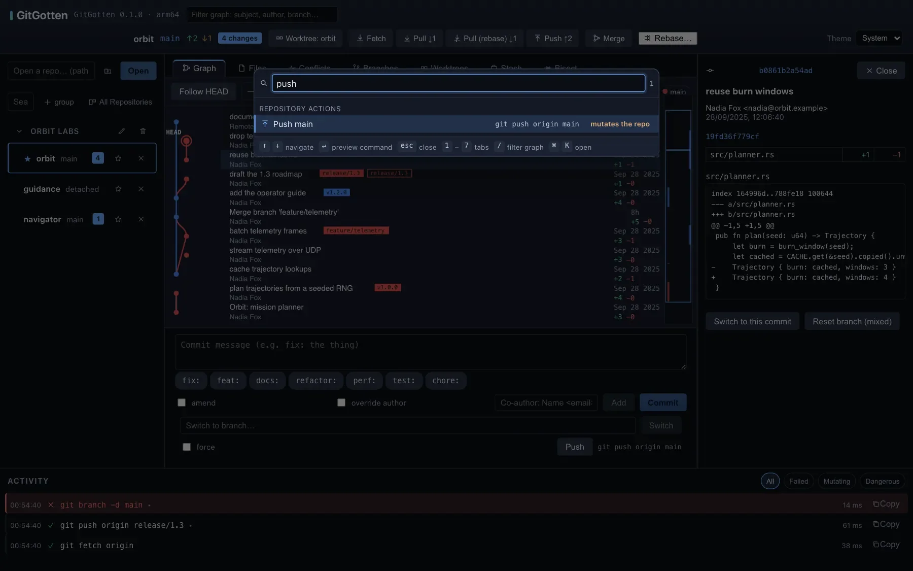 | |

<details>
<summary>More screens: whole window, commit preview, type-to-confirm, stash, workspace nav</summary>

| Whole window (dark) | Commit preview: exact plan before it runs |
|---|---|
| 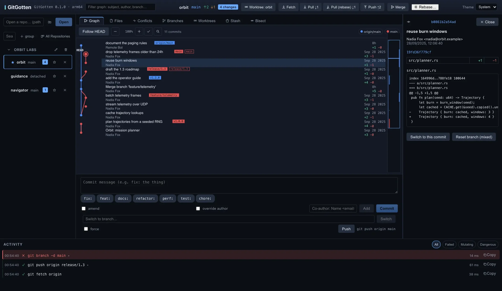 | 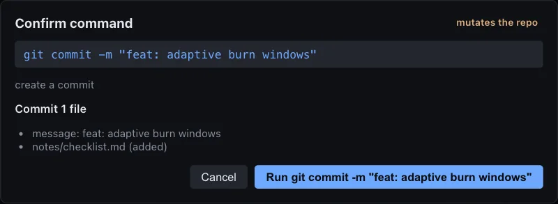 |
| Hard reset needs typed confirmation | Stash push / apply / drop |
| 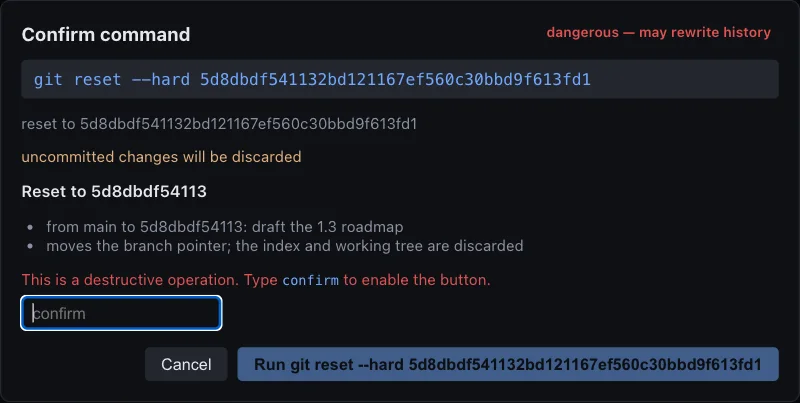 | 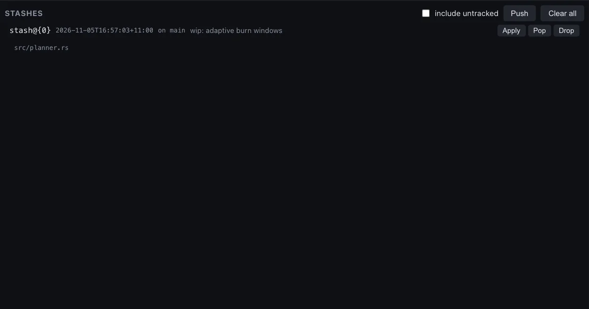 |
| Repo nav: groups, pins, dirty badges | |
| 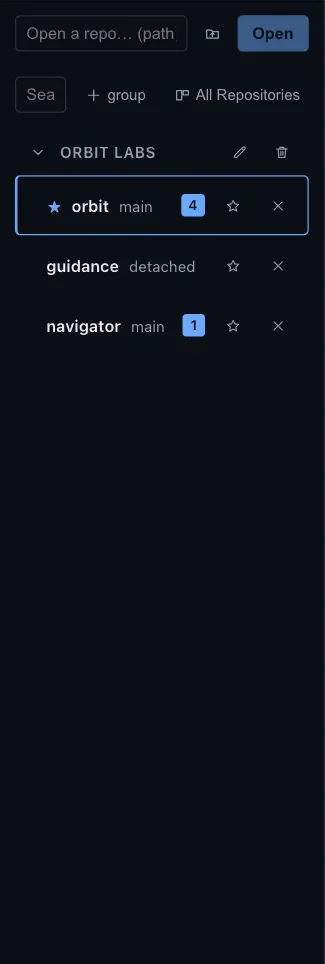 | |

</details>

## Status

**Stages 0–15 built** (stage numbering matches [`PLAN.md`](./PLAN.md)); what remains is
signing / notarization / release infrastructure, not features. Measured on macOS 25.6 arm64,
2026-11-06: `cargo test --workspace` **399 passed** (1 ignored), `pnpm test` **287 passed**
(24 files), `pnpm build` and `pnpm tauri:build` both clean (`.app` + `.dmg`). Full dated
per-platform records: [`STATUS.md`](./STATUS.md).

| Stage | Area | State |
|---|---|---|
| 0 | Workspace + Tauri/React scaffold | ✅ committed |
| 1 | `gix` read model: open repo, live status | ✅ committed |
| 2 | `CommandPlan` + git executor + activity log + preview/confirm | ✅ committed |
| 3 | Commit DAG + lane layout (pure Rust) | ✅ committed |
| 4 | Canvas graph: render, pan/zoom, select, context menu, search | ✅ committed |
| 5 | Per-hunk staging, commit/amend, discard | ✅ committed |
| 6 | Branches, remotes, tags | ✅ committed |
| 7 | Sync: fetch / pull / pull --rebase / push; merge | ✅ committed |
| 8 | Conflicts: 3-way view, resolve, continue/abort, `$EDITOR` hand-off | ✅ committed |
| 9 | Interactive rebase + cherry-pick | ✅ committed |
| 10 | Worktrees: list / add / switch / remove + graph checkout markers | ✅ committed |
| 11 | Stash, submodules, bisect | ✅ committed |
| 12 | Multi-repo workspace (groups, dashboard), persistence, theming | ✅ committed |
| 13 | Hardening: performance + reliability | ✅ committed |
| 14 | Distribution: packaging, signing, auto-updater | ✅ committed (signing/notarization infra missing) |
| 15 | Interface: tokens, responsive layout, icons, graph reading + diff detail, palette, keyboard/a11y | ✅ committed |

## Features implemented today

**Repository & status**

- Open local repositories by path — typed, or chosen in the OS folder picker — with a
  repository registry that matches nested paths.
- Live status: branch, detached state, ahead/behind, staged/unstaged/untracked/conflicted
  changes, in-progress merge/rebase/cherry-pick state; file-watcher driven refresh
  (debounced via `notify`).

**Graph**

- Branch/commit DAG built with `gix`, laid out into lanes, rendered on HTML canvas.
- Zoom/pan, click-to-inspect, hover, search filter, follow-HEAD, late-mount sizing.
- Context actions: create branch at commit, reset (soft/mixed/hard), cherry-pick onto a
  chosen branch.

**Staging & commits**

- Per-hunk and per-file staging via `git apply --cached` (patch on stdin), unstage,
  discard; commit and amend; author override and co-authors.
- Conventional-commit quick prefixes, live command hints, preview/confirm for mutating ops.

**Refs & sync**

- Branches: create, switch, rename, delete, set/unset upstream.
- Remotes: add, remove, fetch.
- Tags: create (annotated/lightweight), checkout, delete, push.
- Fetch, pull, pull `--rebase`, push (with `-u` when needed); merge always `--no-ff`.
- Ahead/behind-aware sync buttons; exact-command previews.

**Conflicts (merge, rebase-stop, cherry-pick-stop)**

- Persistent banner with "k of N resolved", Continue, Abort, Open in editor.
- 3-way combined view (base/ours/theirs regions) plus a sides view and whole-file
  "take our/their version".
- Per-region resolutions: ours, theirs, both, or manual text; applies a patch and stages it.
- External editor resolved from `core.editor` → `$VISUAL` → `$EDITOR` → `vi`.

**Rebase**

- Interactive rebase dialog: reorder commits (drag or ↑/↓), squash / fixup / reword (with a
  message editor), drop, and an `edit` pause that resumes through Continue. The todo is
  prepared and run non-interactively via `GIT_SEQUENCE_EDITOR`, so the preview shows the
  exact todo the rebase executes.
- Rebase onto any branch from the Branches tab; the dialog defaults onto the current
  branch's upstream.
- Rebasing commits already on a remote is `Dangerous`: type-to-confirm with a
  "rewrites N commits on a remote" warning.

**Worktrees**

- List every checkout of a repo (branch or detached commit, path, main/current/locked/
  prunable); add a worktree for an existing branch, a specific commit, or a new branch;
  remove (clean) or force-remove (Dangerous: type-to-confirm, names the lost work).
- TopBar worktree switcher and a Worktrees tab; switching opens that worktree root as the
  active repository, so status, graph, and every op retarget to it. The graph pins each
  worktree's checkout with an outlined marker on the commit it looks at.
- Checking a branch out in two worktrees is refused by git and surfaced as a clean error.

**Stash, submodules & bisect**

- Stash push/list/apply/drop; submodule list/sync/update; git bisect run helper
  with a live panel (good/bad marking, remaining count, culprit found).

**Workspace & theming**

- Nested repo groups with drag-and-drop reorder, pinning (pinned repos top of
  their group), recents ordering, search, and remove-from-workspace (never
  touches disk) — persisted to `app.json` in the OS config dir and re-opened
  at startup.
- All-Repositories dashboard: sortable/filterable live status for every open
  repo; row click switches repos.
- Light + Dark + system-follow theming (persisted), applied to the chrome and
  the branch-lane palette on the graph canvas.

**Performance & reliability (stage 13)**

- The commit graph is cached per open repository, keyed on a fingerprint of every ref
  target, `HEAD` and each worktree's recorded HEAD: browsing, staging and editing
  replay the cached layout (3 ms), while a commit, a ref move, a checkout or a
  worktree change rebuilds it — 116 ms for a 10 120-commit repository, inside the
  300 ms SPEC §18 budget.
- The canvas draws only the visible window of rows plus a margin at every pan and
  zoom level, with a bounded draw-call count at 10 000 rows.
- Ops on a repository serialize against its **common git dir** (so linked worktrees of
  one object database share a turn); 24 concurrent ref-writing ops on one repo all
  land with no `index.lock`/ref-lock error. A compound flow (a bisect test and the
  verdict it decides) holds one turn end to end.
- A failing step stops the rest of its plan and returns git's own output verbatim; a
  mid-op interruption leaves a recoverable state (an interrupted merge stays a
  merge). The web never guesses: every panel re-reads from Rust on `op_finished`, and
  friendly git messages render *above* the raw command + output, never instead of it.
- The activity log is per-repository state — a bounded 500-entry ring mirrored to one
  JSON file per repo, restored on restart, monotonic ids, and rebuilt from scratch if
  the file is corrupt.
- Every repository keeps its own state file (`<hashed id>.state.json`, next to `app.json`): the
  branch→color assignments — a branch keeps the color it was first given, so the graph does not
  re-shuffle when a new branch appears — and the commit you last opened. Reopening a repository
  redraws the graph with the stored colors and reopens the inspect drawer on the stored commit;
  if a rebase or reset rewrote that commit away, the drawer opens on the stored branch's tip.
  A corrupt state file is rebuilt from the repository, never a crash.
- `app.json` also records which repository you were last in, so a startup reopens it - graph, stored
  colors and the commit drawer included - and it never overrides a repo you have already switched to.

**Distribution & auto-update (stage 14)**

- `tauri build` bundles `.app` + `.dmg` on macOS and `.msi` on Windows from one config
  (`bundle.targets = "all"`), with the SPEC §17 floor pinned as
  `bundle.macOS.minimumSystemVersion = "12.0"`.
- The updater plugin is wired on both sides: Rust (`tauri_plugin_updater` +
  `tauri_plugin_process` in `crates/app/src/lib.rs`) and web (`checkForUpdate` /
  `installUpdate` in `api.ts`, an updater slice in `store.ts`, `components/UpdatePrompt.tsx`),
  with `updater:default` + `process:allow-restart` granted to the main window capability.
- Checks run once at launch and every 6 hours while the app is open, against the static
  GitHub Releases manifest
  `https://github.com/sivartydrup/git-gotten/releases/latest/download/latest.json`,
  verified against the minisign pubkey pinned in `tauri.conf.json`.
- An unreachable or unreadable feed is *not* an update: the failure reason is recorded and
  no prompt renders. When a newer release is announced, the prompt shows its version and
  release notes with Install / Dismiss; Install downloads, verifies the signature, installs
  and relaunches.
- A release is built with `pnpm tauri:build --config '{"bundle":{"createUpdaterArtifacts":true}}'`
  while `TAURI_SIGNING_PRIVATE_KEY` / `TAURI_SIGNING_PRIVATE_KEY_PASSWORD` are set (plus the
  `APPLE_*` Developer ID + notarization variables once they exist), and `pnpm release:manifest`
  writes the real signatures into `updater/latest.json` straight from the built `.sig` files —
  `--check` exits non-zero while any platform still holds a placeholder, so a half manifest cannot
  be published. The full sequence lives in `WINDOWS-SIGNING.md`.

**Interface: reading the graph, reading a diff, keyboard (stage 15)**

- Every graph row carries its own diffstat — lines added and removed against the commit's first
  parent (`load_commit_stats` → `Repo::commit_stats` in `crates/gitcore/src/commit_stats.rs`),
  memoized per commit, dropped when HEAD moves, requested in viewport batches capped at 200
  hashes. No rename detection (a rename reports its full deletion plus addition); binary files
  and gitlinks count 0/0 exactly like git's `-` columns; a merge is counted against its first
  parent — where `git show` prints nothing at all.
- A lane is named by the line that is at home in it, so a diverged repository reads as
  `origin/main` and `main` in the legend instead of the same branch twice; the legend shows each
  lane's colour, and the toolbar carries zoom buttons with a % readout, 100%, Fit and a minimap.
- Recent commits show relative time ("38m"), the selected commit lays its ancestry path under the
  lanes, commit dots grow with the diff they carry, and hovering names the author and the time.
- Diff hunks mark the changed *words* inside a line (shared head and tail trimmed; anything
  lopsided marks the whole line), each file header shows its own `+n −m` bar, and Copy path /
  Copy patch put the exact text on the clipboard.
- The activity log filters to All / Failed / Mutating / Dangerous and every entry has Copy.
- ⌘K (Ctrl+K on Windows) opens one palette for repositories, actions and commits; every action row
  shows the Rust-compiled `CommandPlan` command and its risk badge, and a dangerous action still
  lands in the type-to-confirm gate.
- The canvas is keyboard-operable (arrows / Home / End / PageUp / PageDown move the selection,
  Enter inspects, `+`, `-`, `0` zoom); Escape unwinds drawer → graph menu → palette; dialogs trap
  and restore focus; the selected commit is announced in an `aria-live` region; controls are at
  least 28 px and `prefers-reduced-motion` is honoured.
- A window with no repository open shows a first-run panel (`components/EmptyWorkspace.tsx`)
  instead of an empty graph.

## Not implemented yet

macOS code signing + notarization, Windows Authenticode signing, and publishing the first signed
release (which is what makes the update feed live) — all gated on certificates and CI that do not exist
yet; the updater itself is implemented and verified end to end (macOS: launch-time feed check plus the
on-screen prompt; Windows: a signed 0.1.0 → 0.1.1 install inside the installed MSI). The updater key
was rotated on 2026-11-05 and the macOS artifacts rebuilt against it (`WINDOWS-SIGNING.md` §1), so
builds made before that date must be reinstalled; `releases/latest/download/latest.json` 404s until
a release exists.

Linux is deferred (the architecture stays portable).

## Architecture

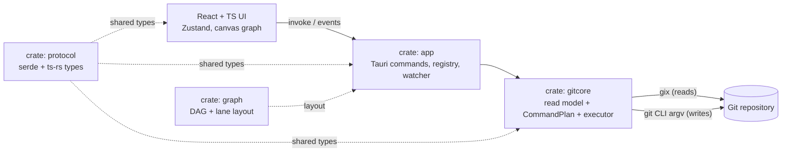

| Crate / package | Responsibility |
|---|---|
| `crates/protocol` | Shared Rust ⇄ TypeScript types (`Op`, `CommandPlan`, `Status`, `Graph`, conflict types), serialized by serde and generated to TS with `ts-rs`. |
| `crates/gitcore` | `gix` read model (open, status, log/graph, refs, diffs, conflicts), the `Op` → `CommandPlan` compiler, and the async executor that runs argv vectors against the real `git` binary. |
| `crates/graph` | Pure DAG construction and lane layout, plus an SVG debug renderer and oracle tests. |
| `crates/app` | Tauri v2 shell: commands, backend state/registry, op queue, activity log, file watcher, updater + process plugins. |
| `crates/testutil` | Dev-only real-git fixtures: temp repos, bare remotes, deterministic dates. |
| `src/` | Web UI (`git-gotten-web`): React 18, TypeScript, Vite, Zustand, Vitest. |

**Layout**

```
git-gotten/
  Cargo.toml                 # Rust workspace
  package.json               # root: @tauri-apps/cli + scripts
  SPEC.md  PLAN.md  README.md  STATUS.md
  docs/assets/               # screenshots used above
  crates/
    protocol/ graph/ gitcore/ app/ testutil/
  src/                       # Vite root for the web UI
    package.json  vite.config.ts  index.html
    src/                     # React app, components, store, tests, styles
  updater/latest.json        # release-manifest template (signatures filled per release)
  crates/app/tauri.conf.json # Tauri config (productName GitGotten, identifier com.sivartydrup.gitgotten)
```

### The transparency invariant

Every write is an `Op` (e.g. `StageHunks`, `Merge`, `ResolveConflict`). `gitcore::plan`
turns it into a `CommandPlan`:

- `display` — the exact command string shown to the user;
- `steps` — argv vectors (never shell strings) plus summaries and effects;
- `risk` — `Read` / `Mutating` / `Dangerous`;
- `preview` — headline, effect lines, and type-to-confirm for dangerous operations.

The UI previews mutating plans, runs them through the app's per-repo queue, and appends
the command, exit code, stdout/stderr, duration, and conflict handoff to the activity log.

## Getting started

### Prerequisites

| Platform | Requirements |
|---|---|
| All | Rust stable (`rustup`), Node LTS + `pnpm`, Git on `PATH`, `pnpm add -D @tauri-apps/cli` (installed via `pnpm install`) |
| macOS | Xcode Command Line Tools. Primary dev/test platform. |
| Windows | **Visual Studio 2022 Build Tools** with *Desktop development with C++* (MSVC + Windows SDK), **WebView2 runtime** (preinstalled on Windows 11 / current Windows 10), Rust's MSVC toolchain (`stable-x86_64-pc-windows-msvc`). Rust must be on `PATH` (`%USERPROFILE%\.cargo\bin`). |

Verified working set (2026-11-04, Windows): Rust 1.99.1 MSVC · VS Build Tools 17.14.42 ·
Windows SDK 10.0.26100 · WebView2 155.x · Node 26.13.0 · pnpm 10.34.9 · Git 2.56.0.

### Install, run, build

Run from the repository root:

```bash
pnpm install          # root: Tauri CLI
pnpm --dir src install
pnpm tauri:dev        # dev window (Vite on :1420)
pnpm tauri:build      # release build (per tauri.conf.json bundle targets)
cargo run -p git-gotten-app   # dev run; needs the Vite dev server on :1420
```

Windows installer:

```bash
pnpm tauri:build --bundles msi
# -> target/release/bundle/msi/GitGotten_0.1.0_x64_en-US.msi
```

The release executable is `target/release/git-gotten-app.exe` on Windows. Bundles stay
unsigned today; see [Building, signing and updating](#building-signing-and-updating) for
what a signed release needs.

### Tests

```bash
cargo test                  # Rust: 399 tests (unit + integration + real-git fixtures)
pnpm test                   # Web: 287 tests (Vitest + Testing Library)
pnpm build                  # tsc + Vite production build
```

Test strategy:

- **Real repositories, not mocks.** `crates/testutil` creates temporary repos with the real
  `git` binary; fixtures cover staging, refs, sync, and conflicts.
- **Graph oracle.** `crates/graph` layout is checked against `git log --graph` output on
  real histories, plus deterministic commit dates.
- **Command plans as contracts.** Tests assert the exact argv/display for every `Op`.
- **UI behavior.** Component tests drive the real stores against a mocked IPC layer;
  the Rust backend is exercised separately.

## Building, signing and updating

**Unsigned local build** (what development does today):

```bash
pnpm tauri:build     # -> bundle/macos/GitGotten.app + bundle/dmg/GitGotten_<ver>_<arch>.dmg
```

`bundle.createUpdaterArtifacts = false` is what keeps this working with no signing key: an
unsigned build still produces an installer, and the installed app still checks the feed.

**Updater identity:** `pnpm tauri signer generate -- -w ~/.tauri/gitgotten.key` created the
minisign keypair. The public half is pinned in
`crates/app/tauri.conf.json → plugins.updater.pubkey`; the private key stays out of the
repo. The feed is GitHub Releases' static manifest (`…/releases/latest/download/latest.json`)
and `updater/latest.json` is that manifest's template — the same shape the app's manifest
test parses.

**A signed release** adds, at build time:

| Gate | What it needs |
|---|---|
| Signed updater artifacts + `latest.json` | `TAURI_SIGNING_PRIVATE_KEY`, `TAURI_SIGNING_PRIVATE_KEY_PASSWORD`, and an override file setting `bundle.createUpdaterArtifacts` to `true`; produces `GitGotten_<ver>_<arch>.app.tar.gz` + `.sig` on macOS or `.msi` + `.sig` on Windows |
| macOS code signing | `APPLE_CERTIFICATE`, `APPLE_CERTIFICATE_PASSWORD`, `APPLE_SIGNING_IDENTITY` (hardened runtime is on by default) |
| macOS notarization | `APPLE_ID` + `APPLE_PASSWORD` + `APPLE_TEAM_ID`, or `APPLE_API_KEY` + `APPLE_API_ISSUER`; `APPLE_PROVIDER_SHORT_NAME` when the account spans teams |
| Windows code signing | an Authenticode certificate plus `TAURI_WINDOWS_SIGNTOOL_PATH` / `bundle.windows.signCommand` |

`--config` accepts a file path or a JSON string. Pointing a build at a mock feed is done
with an override file setting `plugins.updater.endpoints` and
`dangerousInsecureTransportProtocol`, never a committed config value or a code path.

The Windows-side runbook — getting the updater key onto that machine, building signed
artifacts, filling in `latest.json`, and proving the Install flow against a local feed — is
[`WINDOWS-SIGNING.md`](./WINDOWS-SIGNING.md).

## Windows notes

Discovered while getting the first Windows build green:

- Local test remotes must be plain absolute paths; `git` misparses a `\\?\C:\…` verbatim
  path as an SCP-style `host:path` remote ("hostname contains invalid characters").
  `testutil` strips the prefix for remote URLs.
- The fixture's no-op `core.editor` is `git --version`, not Unix's `true` (there is no
  `true.exe`); the app resolves editors by spawning argv directly.
- Pass a relative patch path to `git apply` in tests; an absolute verbatim path is taken
  for a remote too.
- The Tauri CLI must be able to find `cargo` on `PATH`; rustc finds MSVC/SDK from the
  registry, so a Developer Command Prompt is not required.

## Documentation

| File | Purpose |
|---|---|
| [`SPEC.md`](./SPEC.md) | Product design and decisions — the source of truth for behavior and scope. |
| [`PLAN.md`](./PLAN.md) | 15-stage implementation plan, per-stage acceptance criteria, platform gates, and build workflow. |
| `README.md` | This overview: what exists today, how to build/test, and where the project is. |
| [`STATUS.md`](./STATUS.md) | Dated per-platform verification records — what was actually run, where and when. |
| [`WINDOWS-SIGNING.md`](./WINDOWS-SIGNING.md) | Windows runbook for the stage-14 signing + updater verification steps. |

Per-stage workflow from `PLAN.md`: write failing tests → implement → `cargo test` +
`pnpm test` + `pnpm build` + `tauri build` → hand-verify → commit → push. Commit messages
are `stage-NN: <kebab-summary>`.

## License

MIT — see [LICENSE](./LICENSE).
